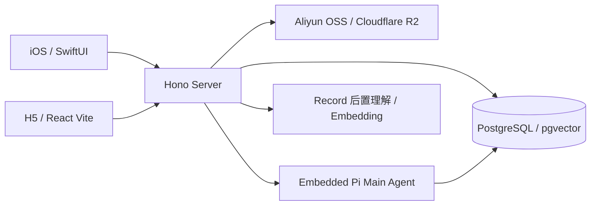

# 系统架构总览

Server 与 Agent 同进程，没有独立 Gateway。H5 通过角色 API 管理多角色，以 default Main 或角色固定 Session 隔离聊天；静态资源由 Nginx 提供；受保护请求使用 Fanto JWT。iOS 使用 Google / Apple 原生登录，H5 是受控测试客户端，Admin 仅本地使用独立只读密钥。

## 事实与派生数据

- PostgreSQL 保存用户、登录身份、Record、Media 元数据、Memory、Fanto 设置、用户资料与 Agent Checkpoint。
- pgvector 保存 records.embedding 与 memories.embedding；对象存储保存 Record 媒体、头像和背景图。
- Main 会话运行在 Pi MemorySessionRepo，Checkpoint 持久化 sessions / entries / usage_ledger；工作目录由 AGENT_WORKSPACE_ROOT 和 userId / sessionId 决定。
- Record 后置理解与 Embedding 使用非持久化内存队列；不会触发额外后台 Agent。

会话权限、停止、保存、恢复见 [Agent Runtime](agent-runtime.md)；模块装配见 [Server](server.md)。数据库健康与部署见 [本地开发](../engineering/local-development.md)。旧数据和外部文件不由启动流程自动删除。
