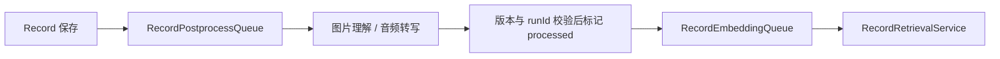

# Business Server

入口为 `apps/server/src/bootstrap/main.ts`。Hono、Domain、Main Agent、Record 后置处理和 Embedding 在同一进程中装配。

## 模块边界

- bootstrap：配置、数据库、健康检查和服务装配。
- routes：HTTP 输入、统一 Session 用户边界与响应；Agent 路由负责 Session / Stream / History / stop。
- domain：Records、Media、Memory、Fanto、Users、Auth 和只读 Admin。
- agent：Pi Harness、Session、Tool、Prompt、Context、Checkpoint 与通用 Skills 基础设施。
- event / listeners：仅 RecordPostprocessQueue、RecordEmbeddingQueue 与监听器。
- infrastructure / migrations：数据库、对象存储、图片理解、音频转写、日志和基线。

路由通过 Service 访问领域；Tool / Context Provider 通过 agent/business-services.ts 调用获准能力。用户来自服务端认证 Session 的 userId 归属，不接受模型或客户端替换。Admin 独立通过 X-Admin-Key 校验，只读查询用户、Session 和 Usage。

## 记录事件链路

postprocess 按 userId / recordId / version / runId 认领及写回，旧请求不能覆盖新版本。单媒体失败不阻塞其他 block；Embedding 失败不回滚 processed，也不自动重试。两条队列都在内存中，不持久化、不自动补投。

## 数据库与可靠性

启动执行 Kysely migration 和数据库健康预热后监听。基线仅创建当前用户、记录、媒体、记忆、资料和 Agent Checkpoint 表；已存在对象按名称跳过，不修改旧表定义。部署不自动删除旧表、历史会话、对象存储文件或工作目录；旧表由操作者维护。具体边界见 [本地开发](../engineering/local-development.md#database-migration)。

Main 的运行、停止、同步 Checkpoint 和恢复边界以 [Agent Runtime](agent-runtime.md) 为准。

## 外部调用日志

外部调用统一记录开始、结果与耗时：对象存储 put/get/head/delete、图片 describe、音频 transcribe。R2 使用同一存储契约并标注 provider；不记录媒体内容、对象键、签名 URL、凭据或模型原文。

PostgreSQL 查询写入 LOG_DIR/sql.log，记录执行耗时、结果与安全错误码，不记录参数、查询结果或数据库错误正文。LOG_DIR/service.log 可按 external-call 过滤；这些耗时不是连接池等待或整个业务事务耗时。

## 全平台认证切换（2026-10-22）

Server 认证统一通过 `AuthSessionService`：SHA-256 Token Hash、PG `auth_sessions`、单进程 24h `TtlCache`、7 天空闲 / 30 天绝对期限。Cookie 验证 web，Bearer 验证 native，旧 JWT/Refresh 已删除。
