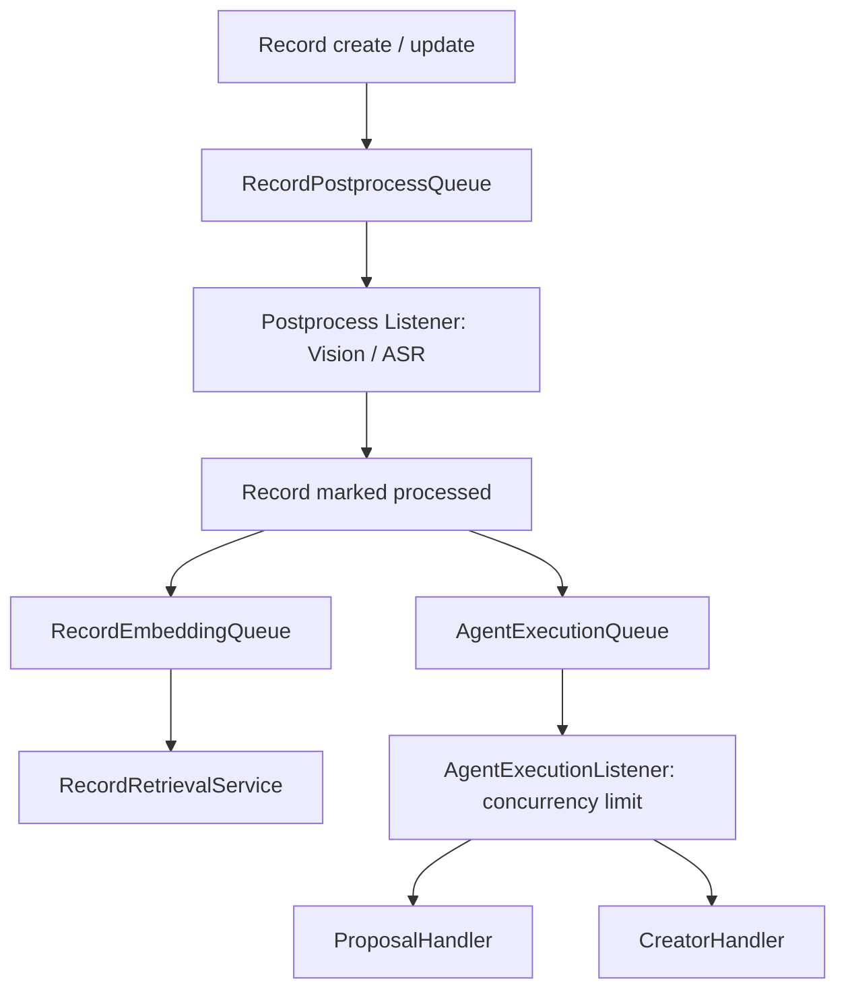

# Business Server

代码入口：`apps/server/src/bootstrap/main.ts`。Hono、Domain、Agent Runtime、异步队列和 Listener 在一个进程中装配。

## 模块边界

```text
apps/server/src/
├── bootstrap/         # 启动、配置、Hono 装配
├── routes/            # HTTP 校验、鉴权上下文、响应
│   └── agent/         # Session History / Events / Stream
├── domain/            # records / media / memory / projects 等领域
│   ├── projects/      # Proposal、Project、CreativeService
├── agent/             # Pi Harness、Session、Tool、Prompt、Skills
├── event/             # Record / Embedding / Agent Execution 队列与 SessionEventBus
├── execution/         # AgentWorker、AgentExecutionListener、各业务 Handler
├── listeners/         # Record postprocess、Record embedding
├── infrastructure/    # DB、OSS、AI Client、缓存、日志
└── migrations/        # schema 基线与前向增量
```

路由只处理输入与响应边界；领域操作交给 Service，Agent Tool 只能通过 `agent/business-services.ts` 访问领域能力。受保护请求均从验证后的 Access JWT `sub` 获取 userId。用户状态与 Record 首页缓存是单进程 TTL 缓存，不具备多实例失效广播。

## 事件链路



postprocess 按 `userId/recordId/version/runId` 认领与写回；单个图片或音频理解失败不会阻塞其他 block。Record 一旦写入 processed，Embedding 失败仅记录日志，不回滚 Record 或自动重试。Proposal 仅在创作能力启用时由 Listener 投递；无价值记录允许不产生提议。

`AgentExecutionQueue` 的 Listener 持有内存 pending 列表和 active Set，`AGENT_EXECUTION_CONCURRENCY` 控制 Proposal / Creator 的共享并发。无需持久化消息；不是可靠 MQ。队列消息、运行事件、进程中断时尚未完成的工作都没有自动恢复/补投保证。

## Project / Agent 执行

Proposal accept 在事务中确定所选 Idea，创建或更新 Project 为 `queued`，提交后向 AgentExecutionQueue 发布 Creator 消息。CreatorHandler 认领 `queued→running`，创建/复用绑定 Session，执行并将 Project 状态设置为 `completed` 或 `failed`。后续用户消息直接走通用 `/api/agent/stream`，请求 metadata 可包含 projectId；Creator Tool 通过 userId、projectId 和 Session 绑定校验权限。Stream 不更新 Project 状态；失败作品经授权 Creator 保存成功可恢复 completed；不再有 Project 专属 POST 消息路由。更多语义见 [创作执行](creative-runtime.md)。

## 数据库与可靠性

Fanto 基本资料与主对话角色统一由 `domain/fanto` 管理，数据与头像生命周期见 [Fanto](../domain/fanto.md)。

启动先执行 Kysely migrations、健康预热再监听端口。最新空库基线是 `create_current_schema_20261019.ts`，仅含当前 Agent Checkpoint 三表。已执行完整业务迁移的旧数据库可合并 Kysely 历史；此前若将三张 Agent 表全部删除，迁移会在事务内重建空的 Session 存储并清理失效的默认会话指针。已有业务表不重建；不要删除 `kysely_migration` 以强制重建。具体归并条件见本地开发文档。生产连接、健康与部署见 [本地开发](../engineering/local-development.md)。

目前不提供队列消息持久化、自动失败重试、重启执行恢复或跨实例调度协调；任何规模评估应考虑这些真实限制。

## 外部调用日志

`LOG_DIR/service.log` 的 `external-call` 记录 OSS（put/get/head/delete）、图片（describe/review/generate/download）和音频转写（transcribe）的调用开始、成功或失败。每次调用用 `callId` 关联开始与结束，结束包含 `outcome` 和 `durationMs`（毫秒）；可用时记录模型、HTTP 状态与安全错误码。成功表示调用返回并通过 Client 结果校验，不记录响应正文。OSS 签名 URL 是本地生成，不产生外部调用日志。R2 同样使用 `service=oss`，另有 `provider=cloudflare-r2` 字段。

OSS 上传/下载记录 `bytes`；图片 download 记录 `downloadBytes`（供应商返回文件）、`bytes`（转码后 PNG）及 `width/height`，其耗时包含下载、解码和 PNG 转码。图片理解、审核、生成及结果下载统一位于 `infrastructure/clients/image-client.ts`。日志不包含对象键、签名 URL、凭据、Prompt、图片描述或转写文本。业务链路关联仍见 [创作执行日志](creative-runtime.md#日志排查)。

PostgreSQL 复用 Kysely 查询日志，写入 `LOG_DIR/sql.log`：`outcome` 为 succeeded/failed，`cost` 是 SQL 执行耗时（毫秒），失败可含 SQLSTATE/errorName；不记录参数、查询结果或数据库错误正文。该耗时不是连接池排队或事务整体耗时。

```bash
rg '\[external-call\]' logs/service.log
# 实时观察 OSS、图片和音频调用
tail -f logs/service.log | rg --line-buffered '\[external-call\]'
# PostgreSQL 查询日志
tail -f logs/sql.log
```
