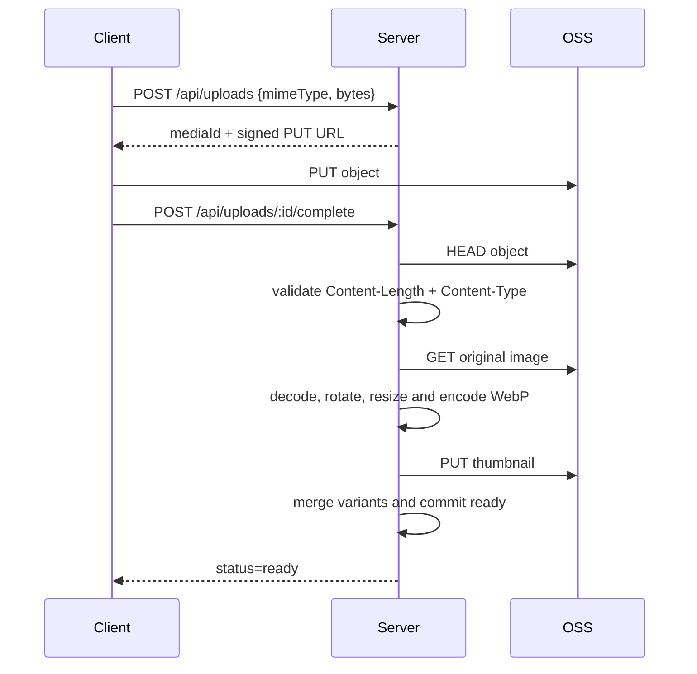

# Media

Media 负责 Record 使用的图片与音频资产。二进制内容存储在阿里云 OSS，业务元数据保存在 `media_assets`。

## 支持格式

| 类型 | MIME |
| --- | --- |
| Image | `image/jpeg`、`image/png`、`image/webp` |
| Audio | `audio/mp4`、`audio/mpeg`、`audio/wav` |

用户上传图片上限 10 × 1024 × 1024 bytes（10 MiB），音频声明大小上限 50,000,000 bytes。H5/iOS 在上传前验证；Server 申请和 complete 分别检查声明与 OSS 实际大小。

## 上传链路



Server 根据 MIME 决定 media type 和对象后缀。complete 时会验证 OSS 实际对象大小和 MIME；不一致返回 `UPLOAD_MISMATCH`。

用户主动上传的媒体对象键为 `users/<userId>/record/<YYYY-MM>/<mediaId>.<extension>`。创作图片直接保存至 `users/<userId>/project/<projectId>/`。只有图片正式进入 Project 正文/封面时，才在 Project 保存事务中对外部来源的媒体创建副本。客户端通过 Media URL 接口读取短期 OSS signed URL。Project 正文通过 `fanto-media://<mediaId>` 引用媒体，客户端在渲染时解析为短期签名地址，不持久化 signed URL。Fanto 不提供独立的 Task 文件上传/交付与 Task Artifact 预览。

一个图片 mediaId 对应原图和 `<mediaId>.thumbnail-v1.webp` 两个对象；`object_key / mime_type / bytes` 仍表示原图，`ext_data.variants.thumbnail` 保存小图 key、版本、类型、大小、尺寸和源 ETag。生成小图不依赖存储商图片处理接口。图片解码验证声明格式、最多 4000 万像素，自动校正 EXIF 方向，保持比例、不放大、不保留 EXIF，动态图片取首帧；capture 尺寸以实际解码为准。

图片 complete 必须完成小图存储后才能在短数据库事务中合并 metadata 并标记 ready；失败保持 uploading。重复 complete 已 ready 的媒体直接成功；对象已写入但 DB 失败时按源 ETag 和版本复用小图。单进程最多两个生成任务同时执行、最多八个等待任务，网络与编码有超时，处理预算 60 秒，客户端 complete 超时 90 秒。未找到原对象返回 `UPLOAD_NOT_FOUND`，无效图返回 `INVALID_IMAGE`，临时失败返回 `UPLOAD_INCOMPLETE`。

H5/iOS 任一保存步骤失败均提示“保存失败，请重试”，保留草稿和上传阶段，不自动重试；用户再次保存时复用凭据和已完成步骤。上传响应丢失时，仅在用户再次保存后先调用 complete，明确原对象不存在才重新 PUT。已完成上传可用于再次创建 Record。此机制不提供 Record 创建请求的幂等保证。

ready Media 才能关联到 Record。关联后 `ext_data.recordId` 记录归属，避免同一媒体被不同 Record 重复使用。

## 图片理解

Record postprocess 发现 image block 尚无 description 时，会通过 Vision Client 使用 OSS 读取地址生成描述。成功结果写回该 Record block：

```json
{ "type": "image", "mediaId": "...", "description": "..." }
```

图片理解失败只记录日志，不阻断其他媒体处理。

## 音频转写

Audio block 在 Record postprocess 中调用 ASR。成功后，transcription 与 ASR 状态、模型、语言、情绪、完成时间都写入 Record audio block。失败时 audio block 写入 `asr.status=failed` 与错误码，不产生 transcription。

`media_assets.ext_data` 继续保存上传阶段 capture metadata（包括可用的 `durationMs`）与 Record 占用关系；ASR 结果不再写入 Media。Record 创建 / 更新时会把 capture 中的音频时长复制进 audio block。

当前没有独立的“上传后立即转写” SSE API；音频理解属于 Record 后置处理的一部分。

## 读取

三个读取接口都先校验当前用户和 ready 状态，不存在、未完成或不属于当前用户的媒体统一返回 `404 NOT_FOUND`：

- `GET /api/media/:id`：302 到原始媒体的短期 OSS 读取地址；
- `GET /api/media/:id/url?variant=original|thumbnail`：返回 `{ url, expiresAt }`；不传 variant 时默认为 `original`。图片 `thumbnail` 返回服务端预先保存的宽不超过 600、质量 80、WebP 小图；音频始终返回原始媒体；
- `GET /api/media/:id/meta`：返回稳定的 `mediaId / mediaType / mimeType` 与可用的 `width / height / durationMs`，不返回 OSS 地址。

已有 ready 图片缺少 variants 时，在本人首次请求 thumbnail 时补生成并合并最新 ext_data，保留 Record 占用信息；原图路径不搬迁。补图失败返回 `503 MEDIA_UNAVAILABLE`，不回退为原图。

`present_media` Agent Tool 使用 `/meta` 对模型给出的 mediaId 做用户归属与 ready 校验，并把稳定 metadata 写入原生 Tool Result `details`。短期 signed URL 不写入 Agent Session，真正展示或播放时再由客户端调用 `/url` 获取。缩略图 URL 与原图 URL 必须按 variant 独立缓存；业务 API 不直接暴露永久 OSS URL。

## Project 媒体与创作图片

`image_generate` 以多张用户可访问的 ready 参考图片调用模型，服务端可短暂生成适配 JPEG 和签名链接，调用完成删除临时对象。模型每次只返回单张图片，完成下载/解码后保存到 `users/{userId}/project/{projectId}/{mediaId}.{ext}`，原图和小图均存储成功后注册新的 ready Media，并只给 Agent 返回 mediaId/mimeType/width/height。不使用 Run、预算、图片槽位或独立进度表。

`project_manage` 在最终保存 Project content/coverMediaId 时校验每个媒体归属：原 objectKey 已在当前 Project 前缀下则直接使用，否则复制 OSS 对象、创建新的 mediaId、独立原图与小图和媒体资产，将最终内容中的引用换成新的 ID。同请求重复媒体引用复制一次。仅用于参考、不进入正式作品的 Record 图片无需副本。

## Record 删除与媒体清理

删除 Record 时锁定其媒体资产，同事务删除 Record 独占媒体的 `media_assets` 并收集原图与小图的 objectKey。Project 最终作品已使用独立 mediaId 和 objectKey，不再阻止原 Record 媒体被删除。聊天历史的原 Record 图片引用也不会阻止删除。

事务提交后 Server 尽力逐个删除 OSS 对象（单对象清理限时）；网络删除失败只记录日志，不存在持久化删除队列、周期扫描或退避重试。HTTP 删除成功只保证业务事务已提交，不保证 OSS 对象必已删除。

## 存储适配

业务依赖 `ObjectStorage` 的异步签名、标准 HEAD、限量读取、写入 metadata 和删除接口；启动工厂当前装配 `AliyunStorage`。原图/小图选择、生成和用户权限均在媒体业务层。接入 R2 需要实现同一 Client、增加配置和工厂分支，并配置对应资源、域名和 CORS；业务与 HTTP 契约不变。
