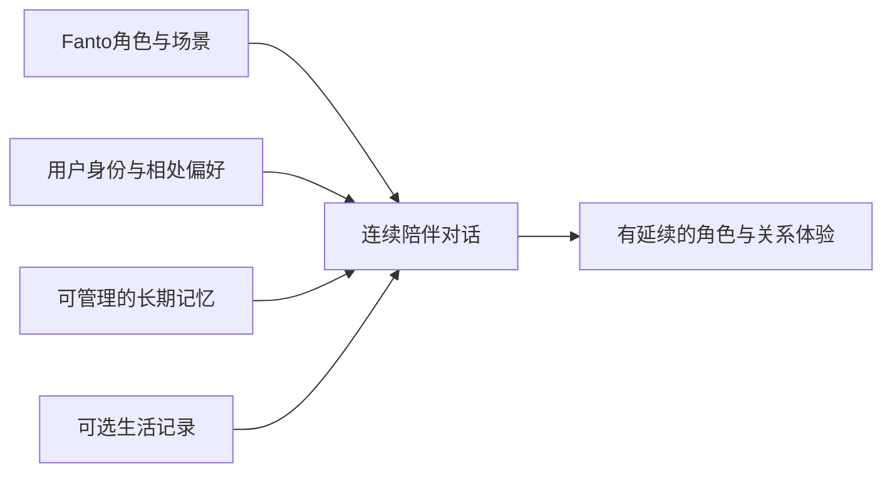

# Fanto 产品愿景

## 定位

Fanto 以角色扮演与深度陪伴对话为产品主线。用户可以设定 Fanto 的身份、性格、表达方式、互动场景与交流边界，在持续交流中建立连贯、有记忆、可掌控的相处体验。

> 角色有延续，相处有记忆。

深度来自稳定的角色表达、对上下文的理解、适时记起共同经历以及尊重用户偏好，而非增加消息数量、亲密等级或主动打扰。角色扮演支持虚构身份与情境，同时区分故事内事件和现实用户资料，避免把剧情误当成用户事实。

## 核心体验

1. **它是我设定的那个角色**：角色、语气、场景与关系在连续对话中保持一致，用户可以随时修改。
2. **我们之前的对话有意义**：记忆和上下文帮助交流自然延续，用户无需反复介绍自己。
3. **我决定如何相处**：用户控制自己的称呼、对话偏好、记忆与边界，能纠正或结束不合适的互动。

## 产品结构

- **Fanto**：主要交流空间。角色设定从对话左上头像进入，保持对话和角色身份的直接联系。
- **记录**：可选的生活表达与回忆入口，为交流补充真实经历，用户不必先记录才能开始聊天。
- **我的**：承载用户头像、昵称、签名、外观与强调色偏好、账号与登录和数据说明。个人资料与 Fanto 角色设定分开管理。

当前 iOS 隐藏“脉络”，不将 Proposal / Project 创作作为主线；保留现有模块与服务端能力。隐藏客户端入口不等于关闭配置已启用的后台创作，相关运行约束见架构文档。

## 验证重点

- 角色是否稳定，表达是否符合设定，剧情和交流能否自然衔接。
- 记忆是否准确并在适当时机出现，用户是否能理解和纠正。
- 用户是否愿意自然地再次交流，而不是为维持连续天数或分数被迫回来。
- 个人资料、角色设定与记忆是否边界清晰，用户能否控制相处方式。

这些是产品方向与体验目标，不代表所有机制已经实现。当前代码能力以 [当前范围](current-scope.md) 为准。
