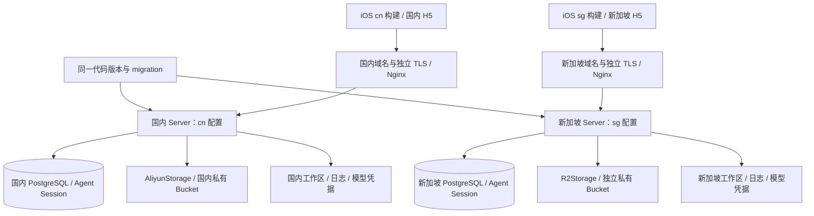

# 国内 / 新加坡双站点改造方案

日期：2026-10-11。状态：待实施方案，不代表当前已实现能力。

## 1. 目标与范围

同一份业务代码、同一套 Schema / migration，在国内 cn 与新加坡 sg 分别部署单进程 Server。两个站点各有配置、启动和部署入口、域名、TLS 证书、数据库、对象存储、JWT 密钥、模型凭据、工作区、日志与备份。客户端连接所选站点，该站点处理整条业务链路。

第一期仅对象存储存在实现差异：cn 使用 Aliyun OSS，sg 使用 Cloudflare R2；数据库继续使用标准 PostgreSQL + pgvector，AI 和身份认证继续复用当前 Client，但两站点独立配置与管理凭据。相同 OAuth App audience 可以按实际应用分发方式复用，不能据此共享 Fanto JWT 或站点用户数据。

本期不做跨站点数据同步、账号合并、自动故障转移、GeoIP 分流、运行时站点切换、多实例执行、通用服务商插件框架或历史 OSS 数据搬迁。国内保留现有数据库与 Bucket，新加坡以独立空库和 Bucket 初始化。站点独立账户：同一 Apple / Google 身份登录两站点，也分别产生本地用户与业务数据。

“新加坡站点”表示服务部署在新加坡、使用独立资源，不等于所有外部服务数据只在新加坡落盘或处理。R2 的 apac location hint 是尽力而为的位置提示，不保证新加坡驻留；目前官方列出的 jurisdiction 不包含新加坡。若目标是严格新加坡数据驻留，需要另行选择有该保证的存储并检查模型、认证及备份的处理位置，不能把 R2 配置成 sg 就声明达成。

## 2. 已验证现状

以当前工作区代码为基线，工作区存在其他未提交变更；实施时应保留这些变更，不以旧 plan 判断现状。

| 入口 | 当前事实 | 必要变化 |
| --- | --- | --- |
| `bootstrap/config.ts` | 单份 AppConfig.oss；loadEnv 默认读取 cwd/.env 并覆盖已有环境变量；OSS 密钥允许空值 | 显式选择站点与 env 文件；按 provider 严格校验 |
| `bootstrap/main.ts` | 直接 new OssStorage；业务、Agent、队列同进程；启动自动 migration | 在装配层创建选定的存储 Client |
| `bootstrap/migrate.ts` | 同样读取默认 .env，并加载完整应用配置 | 与 Server 使用同一站点选择；migration 仅校验其所需配置 |
| `oss-client.ts` | 上传签名、读写、HEAD、删除和 OSS 图片处理 | 提取稳定契约；Aliyun / R2 两个实现 |
| `media-service.ts` | 依赖 OssStorage 类型；complete 直接读取 head.res.headers | 依赖接口与标准化 metadata |
| `record-postprocess.listener.ts` | 同步生成 signed URL，再传给 Vision / ASR | 配合异步 URL 签名改为 await，包含错误处理 |
| 部署脚本 / PM2 | 默认 apps/server/.env、fanto-server、logs、单份 H5 dist | 站点独立入口与路径、PM2 实例名、构建产物 |
| Nginx | 固定 fanto.robinverse.me、robinverse.me 证书路径和 H5 目录；部署 HTTPS 检查使用 -k | 分站点域名 / 证书；验证可信证书 |
| iOS | Auth / Fanto / Agent / RecordWrite 四个 Client 写死相同域名 | 统一站点配置并注入 |
| iOS 持久化 | Auth 固定 Keychain key，Agent 按 user+agent，Record 快照按 user | 加入站点 namespace |
| H5 | 相对 /api 请求，依赖同域 Nginx；认证为受控测试 refresh token | 保留同域，分站点构建参数与测试凭据 |

当前部分配置 / 开发文档还含 Task 或 SQLite 的过时说明；本方案以代码确认的 PostgreSQL Agent Session 与无 Task 运行链路为准，不顺手刷新所有文档。

## 3. 运行拓扑与职责



一个进程只装配一个站点和一个存储 Client。站点不是请求参数，也不是数据库行级 tenant；不在业务表新增 site_id。每站点继续保持 instances=1 / fork，因为 Session reserve、队列和缓存尚无跨进程协调。两站点可独立发布，但每次记录所用 commit，以便复现。

只有 bootstrap 的工厂根据 storage.provider 选择实现；Domain、Listener、Agent 不判断 cn/sg 或 Aliyun/R2，不接触 SDK 对象。业务继续保持 user-scoped 查询，站点隔离不能代替用户授权。

## 4. 统一存储契约

建议新增 `infrastructure/clients/storage/object-storage.ts`、`aliyun-storage.ts`、`r2-storage.ts`，以及 `bootstrap/create-storage.ts`。接口只覆盖当前实际使用能力，保留媒体变体参数，避免额外引入图片网关或新服务。

```ts
type MediaVariant = "original" | "thumbnail";
type SignedUrl = { url: string; expiresAt: string };
type ObjectMetadata = { bytes: number; contentType: string };

interface ObjectStorage {
  putUrl(key: string, contentType: string): Promise<SignedUrl>;
  readUrl(key: string, variant?: MediaVariant, expiresSeconds?: number): Promise<SignedUrl>;
  putObject(key: string, data: Buffer, contentType: string): Promise<void>;
  getObject(key: string): Promise<Buffer>;
  head(key: string): Promise<ObjectMetadata | null>;
  remove(key: string): Promise<void>;
}
```

契约约束：

- 上传签名默认 900 秒；读取默认 300 秒；生成参考图显式使用 900 秒。实现返回 URL 和对应 expiry，领域层不再分别估算过期时间。R2 异步签名，因此全部签名方法统一 Promise。
- HEAD 的确定性对象不存在返回 null；权限错误、网络超时、供应商错误抛出经过脱敏的错误。缺失 / 非法长度和 MIME 不允许验证通过，不把未知状态当成空对象。
- complete 保留现有 mismatch / incomplete 与 ready 语义；无对象 / 外部失败为 incomplete，存在但长度或 MIME 不匹配为 mismatch。MIME 继续按现有 normalizeMimeType 比较。
- remove 对对象不存在幂等成功；其余错误可观察，保留 Record 删除提交后尽力清理的既有语义，不新增自动重试队列。
- getObject 始终 Buffer。原图签名必须指向当前私有 Bucket；SDK 响应、密钥、对象 URL 和签名参数不进入领域层或日志。
- 外部调用日志增加安全的 provider/site 字段，保持耗时、结果和安全错误码；不要输出签名 URL、原始 SDK 错误正文和配置全文。

AliyunStorage 包装现有 ali-oss，保留原图及 OSS 实时缩略图行为。R2Storage 使用 `@aws-sdk/client-s3` 与 `@aws-sdk/s3-request-presigner`，显式配置 endpoint、bucket、独立 scoped credentials，签名 region 使用 auto。对 HEAD 的 ContentLength / ContentType、GET Body、404 等在适配器内标准化。

需要逐个改造现有签名使用处：createUpload、readUrl、redirectUrl、withGenerationReferences，以及 postprocess 的 Vision / ASR。SDK 签名失败必须进入现有 Promise 错误处理，不能将 Promise 当 URL 传入模型或 JSON 响应。

### R2 缩略图

R2 的 S3 API 不能直接承接 Aliyun x-oss-process。第一期在 R2Storage 内复用现有 sharp 生成私有派生对象，Aliyun 保留当前实时处理：

1. thumbnail 请求先定位固定版本的派生键，例如 `<originalKey>.thumbnail-v1.webp`；键包含原对象完整用户 / 项目前缀，调用方不能自行传入任意变体路径。
2. 已存在直接签名；仅当 HEAD 确定不存在时读取原图，限制源文件大小与解码像素，生成宽 600、q80、WebP，写入同一站点 Bucket，再生成签名。
3. 明确方向旋转、纵横比和小图放大规则，并与当前 OSS 图片处理结果验收；不是要求字节级相同。thumbnail 有效期从完成生成后的签名时刻计算。
4. 单进程按 key 合并并发生成，限制总并发、超时和内存占用；失败不改变原媒体 ready，不返回伪造缩略图 URL，客户端沿用已有读取失败和重试体验。
5. remove 必须尝试清理原对象及对应派生对象，单个删除失败不能阻止另一项清理尝试；仍采用既有尽力清理与脱敏日志。不增加可靠删除保证。删除与生成竞态最多留下不可再由业务读取的派生孤儿，记录为当前边界；如后续要严格消除孤儿再独立设计持久化清理。
6. 历史 ready 图片也可按需生成，无需回填 media_assets 或增加 migration。非图片在 MediaService 已解析为 original，不进入缩略图流程。

保留 HTTP `{ mediaId, uploadUrl, expiresAt }` 和 `{ url, expiresAt }`，原对象 key、mediaId、user-scoped 校验、Project 正式引用复制逻辑均不改变。

### R2 访问入口

保留私有 Bucket，浏览器 / iOS 根据服务端返回的 S3 endpoint 预签名 URL 直接 PUT / GET；不把 URL hostname 替换成自定义媒体域名。R2 官方预签名 URL 不支持自定义域名，公开 Bucket 也不符合当前私有媒体边界。两站点 API / H5 域名与 TLS 独立，存储下载域名由对应服务商管理。

H5 Bucket CORS 分别允许本站 Origin、实际使用的 PUT / GET / HEAD 和 Content-Type 等请求头；签名绑定的 Content-Type 必须与上传一致。CORS 仅是浏览器策略，真正授权仍由 JWT、归属校验和短期签名完成。

## 5. 配置与启动

建议配置结构：AppConfig.siteId 与 AppConfig.storage 的 discriminated union，provider 为 aliyun-oss 或 cloudflare-r2。siteId 取 cn/sg，provider 显式配置，二者不是同一个字段；本期受控生产 profile 校验 cn→aliyun-oss、sg→cloudflare-r2，工厂本身不硬编码站点映射。

| 类别 | cn | sg |
| --- | --- | --- |
| SITE_ID | cn | sg |
| OBJECT_STORAGE_PROVIDER | aliyun-oss | cloudflare-r2 |
| 存储配置 | OSS_REGION / OSS_ENDPOINT / OSS_BUCKET / OSS_ACCESS_KEY_ID / OSS_ACCESS_KEY_SECRET | R2_ENDPOINT / R2_BUCKET / R2_ACCESS_KEY_ID / R2_SECRET_ACCESS_KEY |
| 数据库 | 独立 DATABASE_URL，保留现有库 | 独立 DATABASE_URL，初始化新库 |
| JWT | 独立私钥、公钥集、kid；issuer 如 fanto-cn | 独立私钥、公钥集、kid；issuer 如 fanto-sg |
| 模型 | 本站独立模型密钥与 endpoint | 本站独立模型密钥与 endpoint |
| 文件目录 | 本站 workspace / logs / H5 dist 与发布路径 | 本站 workspace / logs / H5 dist 与发布路径 |

模型实现本期不变；相同向量维度 768 与当前模型约束保留。分别验证新加坡进程与当前模型服务的双向访问，尤其 Vision / ASR / 生图服务能否读取 R2 签名 URL。资源独立不自动保证模型调用的地域驻留。

建议目录：

```text
deploy/
  common/                 # 共享发布、健康检查、PM2 配置装配逻辑
  cn/
    site.env              # 只含公开站点参数和路径
    server.env.example    # 密钥占位符；真实文件留在服务器
    h5.env.example        # 测试模式 / 站点标识模板
    start.sh / stop.sh / restart.sh / deploy.sh / publish-h5.sh
    ecosystem.config.cjs
    nginx.conf
  sg/
    ...                   # 同样的独立入口与配置
```

共享步骤避免复制复杂部署逻辑，站点入口固定选择自己的 profile，体现独立启动和部署。site.env 记录 API/H5 域名、证书文件路径、Server env 路径、PM2 名、端口、日志与发布目录，不包含凭据；凭据实际放 `/etc/fanto/cn/server.env` 与 `/etc/fanto/sg/server.env`，仅部署用户可读。同站点只有一份权威 server env，避免 provider / JWT 等值多处重复。

应用配置由显式入口在模块加载前注入，推荐统一使用 Node 的 `--env-file=<明确文件>`；main/migrate 不再隐式 loadEnv() 二次覆盖。开发使用显式 dev 入口选择本地文件。同一套逻辑服务于部署、手动启动、restart 和迁移，不能有入口退回旧 .env。进程环境覆盖文件值的优先级固定并记录；受控部署清除或拒绝继承数据库 / 密钥等关键覆盖变量，校验 env 中 SITE_ID 与入口预期相符。缺站点 / 文件 / 本 provider 必需项立即失败，禁止默认回落另一个站点。

注意当前 logger 在模块 import 时读取 LOG_DIR，必须在进程启动前设置；不能在 main 的 imports 之后才加载站点文件。PM2 按 fanto-server-cn / fanto-server-sg 分别管理，restart/stop 不匹配通用 fanto-server。迁移入口只使用站点 / DB 配置，不要求 OSS / 模型密钥；Server 则先完成配置与工厂校验再进行 migration，避免无效部署先写库。

## 6. 域名、证书与部署流程

国内可保留 `fanto.robinverse.me`，新加坡域名待实际确定；文档和模板使用明确占位符，不把示例域名视为已分配资源。每站点 HTTPS 同域提供 H5 和 /api，保留 Agent SSE 的禁用缓冲与超时设置。

每站点独立申请 / 续期 / 安装证书，私钥不入库；Nginx 配置指定本站 server_name、证书、静态目录和 upstream。后续证书续期使用站点独立部署钩子，先 nginx -t 再 reload。优先安装独立站点配置，不继续无条件覆盖全局 /etc/nginx/nginx.conf。

发布顺序：校验站点配置与 TLS 文件 → 安装锁定依赖 → 构建本站 H5 至独立 dist → 对本站 DB migration → 启动 / 重启本站 PM2 → 检查本机 /health → 发布本站 H5 → 校验并 reload 本站 Nginx → 校验证书与本站 HTTPS /health、静态页 → 运行存储 smoke。

HTTPS 本机验证使用本站域名的 --resolve，不使用 -k；并从对应客户端网络验证公网域名。`/health` 继续仅检查 DB，不扩成每次调用存储的检查；存储连接、凭据和签名闭环由发布 smoke 验证。公开响应或安全日志提供 siteId / provider / commit，以识别部署是否选错，不公开资源凭据。

两站点分别保留旧版本和 H5 产物、数据库 / Bucket 备份与日志。发布失败仅处理本站；迁移一旦涉及不可逆操作不能承诺直接回退旧 Server，按 migration 的兼容要求执行。当前队列不持久化，重启影响仍按既有语义，不能将本次站点改造描述为无损滚动发布。

国内 JWT issuer / namespace 切换第一期选择明确重新登录，清理旧凭据、Session ID 与快照；不做模糊的跨站点旧 token 导入。原数据库与媒体保留，重新登录仍能访问国内既有数据。此过程需在发布说明中明确，JWT 公钥集只包含本站验证密钥，不信任另一站点。

## 7. 客户端连接

iOS 第一期开设 CN / SG 两个 Scheme 和对应 Debug / Release xcconfig，构建期写入 FANTO_SITE_ID / FANTO_API_BASE_URL 的 Info.plist 字段。建立唯一 SiteConfiguration 并注入四个 API Client，启动时验证 siteId 和 HTTPS URL，没有隐式默认域名。业务代码和网络协议仍共用。具体 Bundle ID 和 App 分发渠道在发布前确定；若更换 Bundle ID，同步更新 Apple audience、Google 配置和签名 capability。

AuthCredentialStore 的 Keychain service/account、AgentSessionPersistence 的 user+agent、RecordSnapshotStore 的文件路径均加入 siteId；当前配置固定站点，不添加 UI 切换入口。即使两个构建使用同一 Bundle ID 替换安装，也不能加载另一站点 token / Session / 快照。旧无站点 namespace 首次升级清理并重新登录，不将其映射给 sg。

H5 保持相对 /api 与同域代理，本期不增加跨域 API_BASE_URL。分别构建 cn/sg 产物和 VITE_SITE_ID，客户端缓存 key 可增加站点标识；站点 Origin 本身提供浏览器存储隔离。测试 refresh token 由本站签发，分别保存在未提交的受控构建配置中；它会进入客户端包，只允许既有受控测试，不据此宣布 H5 正式公众认证可用。分别指定 Vite mode / envDir / outDir，避免自动读取另一站点 .env 或复用上次 dist。

## 8. 验证与验收

1. 配置：两 provider 正常装配，缺站点 / 错文件 / 未知 provider / 空凭据 / site 不匹配均拒绝；main、migrate、PM2 与开发入口选择一致，import 前日志目录已生效。
2. 契约：两适配器参数化测试 PUT 签名、GET 签名、Buffer、HEAD 标准字段 / 404、幂等删除与失败分类；上传 900 秒、读 300 秒、参考图 900 秒。
3. 业务：申请上传→正确 MIME 直传→complete→原图 / 缩略图；不匹配不能 ready，未授权用户无法取得 URL；Project 副本与 Record 删除仍保持当前语义。
4. 缩略图：R2 首次 / 缓存 / 并发 / 解码失败 / 超时 / 清理；签名不过早计时、原图不被覆盖、派生对象仍私有；Aliyun 参数与原行为回归。
5. 两站点分别以测试用户和测试资源执行真实 smoke，覆盖 H5 CORS、iOS 上传、Vision / ASR 远程读取、生图参考与结果写入；区分 Mock 测试与真实收费调用。
6. 隔离：cn JWT / refresh token 在 sg 被拒绝，反向同样；一个站点资源操作不影响另一个；同 userId 本地快照与 Session 不复用，部署 / 停止 cn 不触及 sg。
7. 运维：bash -n、脚本选择测试、PM2 配置预览、nginx -t、真实 TLS 和域名验证；脚本测试以假命令 / 测试目录验证目标，不在生产库跑隔离测试。
8. 执行 pnpm typecheck、pnpm test 和 iOS 两个 Scheme 的构建；涉及 PostgreSQL 用独立 TEST_DATABASE_URL。当前未提交变更若已有失败，要记录基线与本次差异，不能覆盖现有工作来让检查通过。

完成后针对最终实现更新 `docs/engineering/configuration.md`、`local-development.md`、`docs/architecture/overview.md` / `server.md`、`docs/domain/media.md`、`docs/api/http-api.md`、`docs/clients/ios.md` / `h5.md` 及相关 README / AGENTS.md。说明资源隔离、Client 契约、站点入口与缩略图行为，不复制变量表。产品功能范围没有变化时不把基础设施改造写成新的产品 Capability。此次局部文档更新不自动推进 docs/.checkpoint；完整刷新需要独立覆盖 checkpoint 至 HEAD 的全部影响。

## 9. 外部依据

- [R2 数据位置](https://developers.cloudflare.com/r2/reference/data-location/)：location hint 不保证位置，支持的 jurisdiction 不含新加坡。
- [R2 预签名 URL](https://developers.cloudflare.com/r2/api/s3/presigned-urls/)：S3 API 域名、签名操作与 Content-Type，不能直接使用自定义域名。
- [R2 S3 API 兼容性](https://developers.cloudflare.com/r2/api/s3/api/)：以其支持操作实现 R2 adapter，不假定全部 AWS / Aliyun 能力等价。
- [R2 CORS](https://developers.cloudflare.com/r2/buckets/cors/)：浏览器直传需要按本站 Origin 和实际请求头配置。
