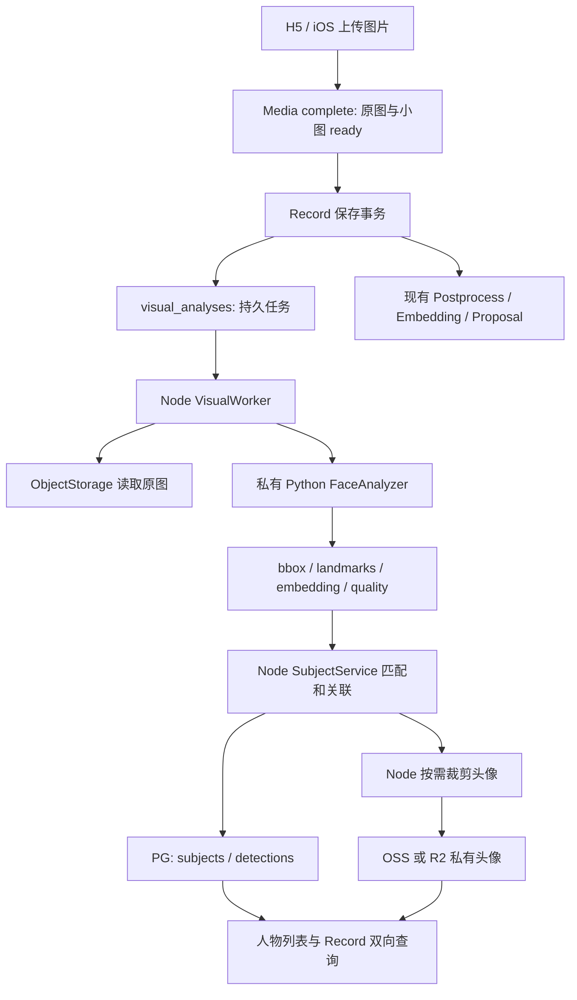
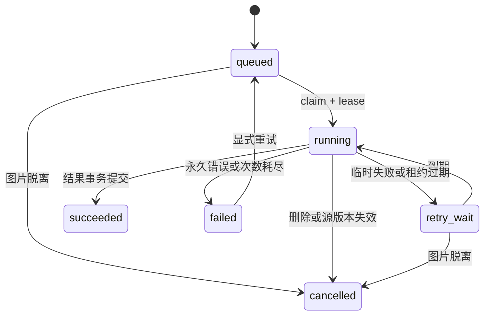

# Fanto 人脸识别服务技术方案

日期：2026-10-17。状态：待实施。本次仅检查与方案设计，没有实现或部署。
检查工具：用户指定的 AgentDock。仓库：/Users/wanghuiru/Workspace/side-project/fanto。
事实基线：HEAD 62e88b751bb92bb613f16534b8bc1f3ac3b11739，检查时工作区干净。
配套执行任务：2026-10-17-face-service-tasks.md。

## 1. 结论与范围

采用 Python + FastAPI + OpenCV 的独立 CPU 推理进程，候选模型为 YuNet 检测、SFace 提取 128 维特征。这里“本地”指 Fanto 自己部署的服务端，不指 iPhone 端推理。
Node/Hono 继续负责鉴权、原图读取、PG 任务消费、匹配、主体管理和头像裁剪。Python 不持有数据库或对象存储凭据，不访问外部图片 URL。
PG/pgvector 保存检测向量与关联；当前站点配置的 OSS 或 R2 保存一张当前代表头像。原图继续属于 Media，不重复保存所有人脸裁剪图。
三张核心表 visual_analyses、visual_detections、subjects；另加仅服务于派生头像对象的清理 outbox 表 visual_object_cleanup，解决存储与数据库无法共同提交的问题。
首期不引入 Redis、独立向量数据库、通用任务平台，也不改造已有三种内存队列。

首期交付：Record 图片人脸检测、匿名人物聚类、命名、头像、人物到 Record/Record 到人物的查询、手动纠错与历史回填。
宠物只预留 subject.type=pet 与 species、可空 embedding；本期不交付宠物自动检测或自动识别，也不复用 SFace 识别宠物。
不推断现实姓名、亲属关系或身份，不自动写入 Memory。Project 生成图与聊天附件不默认加入识别范围。

## 2. 已核实的项目现状

| 范围 | 当前事实与证据 | 设计影响 |
| --- | --- | --- |
| 项目 | apps/server 为 Hono/TypeScript，apps/h5、apps/ios、packages/shared；入口 bootstrap/main.ts | 在现有 Server 内加视觉领域服务，Python 单列 apps/face-service |
| Record | content.blocks 通过 mediaId 引用媒体；最多五个媒体；创建/更新事务校验本人 ready Media；version 乐观并发 | 不把人脸结果写进 content.blocks，不改变 Record 状态机 |
| 保存扩展点 | domain/records/repository.ts 的 RecordSavedHook 带 Transaction；postgres-repository.ts 在 create/update 事务内调用；main.ts 目前传 undefined | 优先接此 hook 登记任务，不依赖提交后的 EventEmitter |
| 原处理链 | record-postprocess.listener.ts 调 Vision/ASR，完成后分别发布 Embedding 与 Proposal | 人脸分析从 Record save 独立启动，不等待或阻塞 postprocess |
| 队列 | event/* 使用 EventEmitter/内存；没有通用可靠消息服务 | 新视觉任务直接使用 PG 持久状态、租约和有限重试 |
| Media | media_assets + ext_data.recordId；image-thumbnail.ts 存 original 与 600 宽 WebP，自动纠正 EXIF；10 MiB、4000 万像素限制 | 读取原图分析，坐标统一到纠正方向后的原图 |
| PG | migration 已启用 vector；Record/Memory/Project 使用 vector(768) 文本向量；config.ts 强制 768 | 人脸 vector(128) 独立保存，不能复用文本 embedding provider |
| 存储 | ObjectStorage 有 head/getObject/putObject/signRead/remove；启动选 AliyunStorage 或 R2Storage | 头像复用同一适配，不固定为 R2，不引入 Cloudflare Images |
| 删除 | Record 删除事务内删独占媒体元数据，提交后尽力清理对象；现有原图清理无持久重试 | 新增视觉数据清理接入删除事务；头像新建可靠清理范围，不声称原图删除已有恢复能力 |
| 部署 | ecosystem.config.cjs 单实例 PM2，Node 内存重启阈值 512M；deploy/manual 部署，Nginx /api 代理 3000 | Python 独立进程，不能套用 Node 的 512M 阈值；不对公网开放推理端口 |
| 健康 | Server /health 检查 PG；当前无 /ready | Python 独立 ready；人脸服务故障不使主站健康检查失败 |

注意：docs/engineering/configuration.md 仍列旧 TASK_* 和 Task 共享并发描述，与 config.ts/main.ts 及已删除 Task 的现状不一致。本方案以实际运行入口为准，不据此假设已有调度器。本次不顺手修正文档。
未连接生产机器、数据库或账单；生产 CPU、RAM、PG 扩展版本、真实流量和照片分布尚未核验。模型性能不是实测结论。

## 3. 组件职责与主链路



1. ready 图片正式关联 Record 的保存事务内，hook 查询该 Record 当前图片集合，创建缺失任务、取消脱离图片的任务并清理其检测关联。事务内只有数据库操作。
2. 每张图片一个任务；唯一键按 userId + mediaId + sourceRevision + pipelineVersion。仅改文字或调整顺序不重复推理。Record version 记录为观察值，不能作为图片推理的唯一失效依据。
3. Worker 启动后立即扫描，随后每 5 秒扫描到期任务；内存唤醒仅降低延迟，丢失唤醒仍可恢复。
4. 认领前/结果提交时都校验用户 active、Record 存在、media 属于本人且 ready、仍在当前 image blocks 中，且 ext_data.recordId 相符。以当前关联为准，不能只检查历史 recordVersion。
5. Node HEAD 获取 ETag，限量 GET 原图，通过 multipart 发给 Python。对照 ext_data.variants.thumbnail.sourceEtag；旧图片缺少该字段时先建立明确源版本。ETag 只作不透明版本标识，不当作内容哈希。计算实际下载内容 SHA-256；HEAD/GET 后再次确认源版本，无一致来源时不提交结果。
6. Python 完成方向归一化、检测、对齐与特征提取，返回结果；Node 严格验证维度、有限数、边界和版本。
7. 短事务验证租约和当前源版本，匹配并保存 detections/subjects，最后标记分析成功。无脸也成功，faceCount=0。失败不会回滚 Record.processed 或影响上传、文本检索与创作。
8. 代表头像需要更新时，复用本次原图 Buffer，以 sharp 按归一化坐标裁剪；存储成功后 CAS 切换 subject 头像，旧对象进入清理 outbox。头像失败单独重试，已成功的 embedding 不重复生成。

## 4. 检测、特征与质量

候选运行组合：OpenCV 4.x 固定经验证的补丁版本 + face_detection_yunet_2023mar.onnx + face_recognition_sface_2021dec.onnx；Python/FastAPI/numpy 同时锁定版本。实施时验证 Linux x86_64/arm64 的 wheels 与模型兼容性。不要跟随 latest 自动换模型。
OpenCV Zoo 目前还提供面向 OpenCV 5.x 引擎的 2026may YuNet，不能只替换文件而不验证运行组合。所有模型随发布包分发，记录下载来源、commit、SHA-256、许可证和特征维度；启动校验并预热，不在首个请求时下载。

处理规则：
- 只接受 JPEG/PNG/WebP，与当前 Media 一致；最多 10 MiB、4000 万解码像素，动态图片取第一帧。Python 在完整解码前检查尺寸，超过预算拒绝，不能只检查压缩大小。
- EXIF 方向统一处理一次；bbox/5 点 landmarks 均使用方向修正后的原始像素坐标，bbox={x,y,width,height}，左上包含、右下不包含，裁剪越界截断。返回 image.width/height/orientationApplied，Node 与 sharp 的 rotate() 结果必须一致。
- 检测图最长边先取 1280、不放大；映射回原图后从原图进行五点对齐，避免用 600 像素小图提取向量。检测大脸尺度覆盖与合照漏检用验收集评估，必要时增加第二尺度，计入 pipelineVersion。
- 每图最多 50 张脸；超过时返回显式截断标记，不把未处理部分报告为完整。业务标记 succeeded + warning，用户可知结果可能不完整。
- detector confidence 先以 0.9 为评估起点；最低人脸尺寸、模糊度、曝光、姿态偏差均在验证集标定。低质量检测仍可展示/人工指认，但 embedding 可为空且不得用于自动匹配。
- SFace 结果先校验 128 个有限 float32，L2 normalize，拒绝零范数。pipelineVersion 包含 detector/recognizer 哈希、方向/缩放/对齐/质量规则版本；matchingPolicyVersion 独立管理阈值和聚类策略。
- quality 保存检测分数、脸部像素尺寸、归一化清晰度、曝光和关键点几何指标。几何代理指标不冒充可靠的 yaw/pitch 或完整遮挡检测。头像选择使用质量排序与改善幅度，避免轻微变化频繁更新。

官方演示中的 cosine=0.363 是特定验证集的人脸验证阈值，不能直接作为 Fanto 的自动聚类阈值。自动合并优先压低误认率，实际阈值和第一/第二候选差值经独立留出集确定。

## 5. API 契约

### 5.1 私有推理 API

Python 监听 127.0.0.1:8100；异机时使用私有网络与服务认证。共享服务密钥放环境变量，通过 Authorization 传输并脱敏；不使用用户 JWT 作为服务密钥。

| 接口 | 请求 / 响应 |
| --- | --- |
| GET /health/live | 进程存活，200 |
| GET /health/ready | 模型哈希校验、加载和预热完成才 200，否则 503 |
| GET /v1/models | pipelineVersion、modelId/modelVersion、dimension、输入预算 |
| POST /v1/faces/analyze | multipart image + requestId + expectedPipelineVersion；同步返回 200 结构化结果 |
 
响应示意（embedding 在此省略，真实长度必须为 128）：
```json
{
  "requestId": "analysis-attempt-id",
  "pipelineVersion": "yunet-sface-v1",
  "modelId": "sface",
  "modelVersion": "2021dec-sha256-pinned",
  "dimension": 128,
  "image": {"width": 4032, "height": 3024, "orientationApplied": true},
  "faces": [{
    "index": 0,
    "bbox": {"x": 820, "y": 400, "width": 280, "height": 330},
    "landmarks": [[900,490],[1010,490],[955,560],[910,625],[1000,625]],
    "embedding": [],
    "quality": {"detectorScore": 0.99, "usableForMatching": true}
  }],
  "truncated": false,
  "timingsMs": {"decode": 30, "detect": 120, "feature": 20}
}
```
无脸 faces=[] 是 200；质量不足的检测 embedding=null。
错误：400 INVALID_IMAGE/INVALID_INPUT，413 IMAGE_TOO_LARGE，409 MODEL_VERSION_MISMATCH，429 CAPACITY_EXCEEDED（Retry-After），503 MODEL_NOT_READY，500 INFERENCE_FAILED。错误正文不得包含图片、向量或底层堆栈。
服务端仅一个正在运行的推理、至多一个短等待请求，满额立即拒绝；requestId 只追踪，不声称 Python 提供持久幂等。Python 不拉取 URL、写头像或接收存储密钥。
Node 请求总 deadline 初始 30 秒；取消 HTTP 不代表 native 推理被取消。Python 以隔离子进程/监督机制落实硬执行超时，超时回收并重载模型后才接受下个任务，避免线程超时后无限积压。

### 5.2 Fanto 对客户端 API（拟新增）

全部沿用校验后的 JWT sub 和现有 success/data/errorCode 包装，不接受客户端指定 userId；跨用户和不存在统一 404，不返回 embedding、内部对象 key 或模型凭据。

| 接口 | 语义 |
| --- | --- |
| GET /api/subjects?type=person&cursor=&limit= | 主体列表，name、status、avatarVersion、recordCount、version；按 updatedAt+id 游标分页 |
| GET /api/subjects/:id | 主体详情与版本 |
| PATCH /api/subjects/:id | name、status、representativeDetectionId、avatarLocked；携带 expectedVersion |
| GET /api/subjects/:id/avatar/url | 校验归属，返回短期私有 signed URL、expiresAt、avatarVersion；无头像返回 data=null |
| GET /api/subjects/:id/records | 按 Record.eventAt+recordId 去重分页，不能以检测条数计照片/记录 |
| GET /api/records/:id/subjects | 当前仍关联图片的检测 bbox、subject 与处理状态；返回观察到的 Record version |
| POST /api/subjects/:id/merge | targetSubjectId、双方 expectedVersion；源变 merged 指向目标，类型/用户必须一致 |
| POST /api/subjects/:id/split | detectionIds、expectedVersion，拆到新主体；记录拆分排斥关系 |
| PATCH /api/visual-detections/:id | subjectId 或 null、ignored、expectedVersion；人工关联优先，null 记录为 manual_unassigned |
| POST /api/records/:id/visual-analysis/retry | expectedVersion；仅重置失败/取消的当前图片任务，202 返回 analysisIds，重复请求复用任务 |

手选代表检测必须属于同用户同主体、关联当前有效图片、质量足够。avatarLocked 时不自动换头像。
冲突返回 409 VERSION_CONFLICT；无效跨类型合并为 400 INVALID_INPUT。请求中出现别人的检测 ID 统一 404。
历史回填首期用受控管理命令按 userId/时间分批登记，不新增面向客户端的大规模重建接口；dry-run 报告数量后由操作者显式执行，限速并可暂停。
本期“移除人物”采用 ignored 隐藏并停止该簇自动扩展，避免下一次扫描立刻创建相同人物；彻底擦除视觉数据与停止收集需单独授权的清除流程，不能把隐藏称为物理删除。
人物列表可先返回主体 metadata，按可见行批量加载头像 URL，按 subjectId+avatarVersion 缓存；不把 signed URL 写回业务表或客户端长期缓存。

## 6. 数据模型与存储

### visual_analyses：一张图片的分析事实和持久任务

analysis_id UUID PK，user_id，record_id，observed_record_version，media_id，source_revision（不透明源版本），source_sha256，pipeline_version。
status=queued/running/retry_wait/succeeded/failed/cancelled；attempts、next_attempt_at、lease_token、lease_expires_at、generation、error_code、face_count、warning、created_at/updated_at。
另有 avatar_status=pending/ready/failed/not_needed 与 avatar_attempts/next_avatar_attempt_at，支持仅重做头像。
唯一 (user_id,media_id,source_revision,pipeline_version)；脱离后重新关联可在同一行增加 generation，旧租约无法提交。重试不改变唯一键。

### visual_detections：每次检测的向量与当前主体关系

detection_id UUID PK，user_id，analysis_id，detection_index，subject_id nullable，type=person/pet，species nullable。
bbox/landmarks/quality JSONB，embedding vector(128) nullable，model_id/model_version，matching_policy_version、assignment_source=auto/manual/manual_unassigned、match_score、ignored、version、created_at。
唯一 (analysis_id,detection_index)；关联不能跨用户；低质量或人工宠物关联可无向量。
首期固定 128 维是人脸空间，未来宠物/不同维度模型用独立 embedding 存储/有类型的向量表迁移，不能给 pet 填伪造的 SFace 特征。

### subjects：持久的主体身份与聚类合并为一表

subject_id UUID PK，user_id，type=person/pet，species nullable，name nullable。
status=discovered/confirmed/ignored/merged，merged_into_subject_id nullable，version、created_at/updated_at。
representative_detection_id nullable、avatar_object_key nullable、avatar_version、avatar_status、avatar_locked、avatar_source_analysis_id。
excluded_subject_ids JSONB 保存用户拆分后的对称排斥关系，首期规模小、在同用户串行事务内维护；后续量大再规范化。
自动新建为 discovered；命名/确认变 confirmed；同名不代表同一个体。
只保留一张当前可见头像，替换期间允许新旧对象短暂共存；旧对象清理后不保留历史头像版本。
保留代表之外的多条合格检测向量，不在 subjects 存放单一向量替代全部样本。

### visual_object_cleanup：派生头像的持久清理 outbox

job_id，user_id，object_key，not_before，attempts，next_attempt_at，status，lease_token/lease_expires_at，error_code。
对象 key 唯一；删除不存在视为成功；只清理视觉头像前缀，不自动扩大到现有 Record 原图。
可通过预登记候选对象 reservation 状态处理“PUT 成功但 DB 未提交”的孤儿：写入预约后才 PUT，切换成功标记 referenced；失败留待宽限期后清理。清理前重新核查无 subject 引用，避免与延迟提交竞争；预约、切换与清理认领使用同一行锁/代际令牌。

### 约束与索引

- 四张表都显式 user-scoped；增加父表 (user_id,record_id)、(user_id,media_id)、(user_id,subject_id) 唯一约束，使用复合 FK 或同事务锁校验保证引用所属用户。代表检测反向循环 FK 可延迟或由事务校验，不能影响插入顺序。
- 索引：analyses(status,next_attempt_at)、running 的 lease_expires_at；analyses(user_id,record_id,media_id)；detections(user_id,subject_id,analysis_id)；subjects(user_id,type,status,updated_at,subject_id)；cleanup 到期/租约索引。
- 首期用用户与模型条件过滤后的精确 cosine 距离查询，表达式 embedding <=> queryVector，similarity=1-distance；不复用当前文本 <-> L2 查询。
- 不默认建全局 HNSW。单用户数据大且实测查询超过预算时再评估索引、过滤后召回、iterative scan/分区以及精确基线对照；索引不是用户隔离边界。
- 新增前向 migration，不能编辑已发布空库基线或清空 migration 元数据。

头像 key：users/<userId>/subjects/<subjectId>/avatars/<avatarVersion>.webp。256×256 WebP，扩脸框约 1.4 倍并按边界裁剪，去 EXIF、不放大小脸；头像是否包含其他人脸需验收。ObjectStorage 直接存储派生头像，不伪装成可被 Record 占用的普通 media_assets。
GET avatar/url 签名有效期初始 300 秒；源头删除后签名缓存最长可能存活至过期，清除操作需同时清理客户端缓存。

## 7. 匹配、聚类与人工纠错

1. 只比较同 userId、type、model_id/model_version/pipeline 特征空间，且当前仍有关联、未 ignored 的合格向量。
2. 按主体选最多 5 个高质量、角度尽量不同的样本参与匹配（保留所有向量供重选）；用最佳样本和第二支持样本共同判断，避免单个离群点把陌生人吸入。
3. 聚合到 subject 后再比较第一、第二不同主体；最高分必须超过标定高阈值，差距必须超过 margin，存在足够支持，且不违反用户排斥关系才自动关联。
4. 无高置信候选则新建 discovered；质量不够则 subject_id=null 待用户指认。不强行分配最近人物。
5. 不自动把两个已有主体合并，避免相似度的链式传递导致整簇污染；自动聚类是保守的增量归组，误拆可由用户合并。
6. 同图不同脸是弱排斥信号；考虑镜子、照片中的照片等情况，默认不自动同时归给同一主体，但人工可覆盖。
7. 对同用户的匹配、主体新建、merge/split 使用 PG transaction advisory lock 串行；提交前重新查候选，避免两个 Worker 并发新建同一个人。模型调用始终在事务外。
8. 手工关联/取消的 assignment_source 不被自动任务覆盖。split 同事务记录两个主体排斥关系；merge 合并排斥集、修正第三方反向引用与代表头像，禁止合并形成环。
9. 所有修改带 expectedVersion；merge 源主体保留 merged_into，读取时解析到目标。split 移动明确检测 ID 并更新双方 version，不做猜测式整簇迁移。
10. 锁顺序：需要 Record/Media 的事务沿现有路径先锁 Record，再按 ID 排序锁 Media，再取用户视觉 advisory lock，再按 ID 锁 Subject/Analysis。任务认领另用极短事务，不跨推理持有锁。仅主体操作不反向获取 Record 锁；清理操作遵守同一顺序，需在集成测试覆盖死锁竞争。

双向关联由 detections -> analyses -> Record 查询；无需复制一套 record_subjects 关系表。Record 移除图片后查询立即排除，不能等异步清理才隐藏。

模型重建：旧人工身份保留，新增 pipeline 的检测先 staging，验证后切换 active generation；基于同源 bbox/landmark 对应迁移手工检测关联，歧义保留旧结果待人工复核，不能按 detection_index 盲迁移。不能跨模型比较向量，也不能清空已命名 subjects。首期只激活一个特征模型，完整双版本上线是后续任务而非隐含已有能力。

## 8. 失败、重试与生命周期

状态机：


- 初始 worker 并发 1；PG SELECT FOR UPDATE SKIP LOCKED 认领，租约 90 秒，每 20 秒续约；所有结果写入带 lease_token + generation 条件。进程重启扫描过期 running，增加 attempts 后重试。
- 临时错误（网络、429、503、存储暂不可用）最多总计 5 次，退避基数 10 秒、30 秒、2 分钟、10 分钟并加 jitter，尊重有限的 Retry-After。不是无限重试。
- 非法图片/超预算直接 failed；模型版本不匹配暂停该 pipeline 消费并报警，避免每张图片浪费五次重试。
- 下载失败、推理失败、聚类提交失败、头像写失败分别记录安全 errorCode。503 超过阈值短暂停止向 Python 发请求，积压仍留 PG。
- Worker 崩溃在推理后、DB 前：重推理但结果不重复；DB 成功而响应丢失：分析已 succeeded，扫描不再执行。
- 头像先准备对象再切换指针；若头像失败，主体和检测仍可见并展示默认头像。独立头像重试也最多 5 次，之后可受控重试；旧头像尚有效时继续使用。
- Record 删除/移除图片：同事务取消分析，删检测及其向量，清空失效代表引用并置 avatar pending；立刻清除依赖该源图的旧头像指针、登记对象清理，再从剩余检测重选。删除所有检测的已命名主体保留空身份但无头像/向量，未命名空主体可清理。
- Record 原图对象的现有尽力清理语义保持；新增头像 outbox 不等于原图获得可靠删除。
- 彻底清除视觉数据时先停收集、取消任务，再删向量/检测/主体并登记头像删除；保留不含内容的清理任务到对象删除成功。用户账号删除需确保 cleanup outbox 不被 users CASCADE 提前删除；采用脱敏 owner/tombstone 或先完成清理再删除任务的策略，实施时明确选用前者并测试。
- 日志只记 requestId/analysisId、耗时、数量、模型版本、错误码与重试次数；禁止图片、embedding、姓名、对象 key、signed URL、Authorization。现有 HTTP access body logger 也需要对新接口的名字/纠错信息和 avatar URL 响应增加脱敏。

## 9. 部署与运行配置

建议目录：
- apps/face-service：服务、模型清单、依赖锁、独立测试；
- apps/server/src/domain/visual：任务/检测/主体 Service 与 Repository；
- apps/server/src/infrastructure/clients/face-client.ts；
- apps/server/src/execution/visual-worker.ts；启动装配留在 bootstrap/main.ts；
- apps/server/src/routes/subjects.ts、visual.ts；
- deploy/manual 中新增 Python 安装/启动/停止/ready 检查，保持现有部署方式。

首期 Linux 同机独立 Python 进程，由 systemd 管理；Node 保持 PM2，Python 使用专用 venv/非 root 用户，Uvicorn worker=1、OpenCV/BLAS 线程先设 1。CPU native 工作放受监督执行进程，FastAPI 事件循环继续响应健康检查。
模型常驻执行进程，只加载一次；父进程不再重复加载。设置 MemoryMax、执行超时、临时文件配额和重启退避。仅监听回环地址，无 Nginx 人脸服务公网 location。
异机扩容时更换 FACE_SERVICE_URL 与私网认证即可；每个站点用本地服务/数据库/对象存储，不默认跨站传原图或生物特征。

拟新增配置（均不是当前已有）：
FACE_ANALYSIS_ENABLED=false；FACE_SERVICE_URL；FACE_SERVICE_TOKEN；FACE_PIPELINE_VERSION；FACE_REQUEST_TIMEOUT_MS=30000；FACE_WORKER_CONCURRENCY=1；FACE_SCAN_INTERVAL_MS=5000；FACE_LEASE_MS=90000；FACE_MAX_ATTEMPTS=5。
Python：HOST/PORT、模型 manifest 路径、MAX_IMAGE_BYTES=10485760、MAX_PIXELS=40000000、MAX_FACES=50、INFERENCE_CONCURRENCY=1、MAX_WAITING=1、EXECUTION_TIMEOUT_MS=30000。
密钥仅存在进程环境。内网异机传输用 TLS/服务身份；不把 token 放查询串。

发布：依赖/模型校验 -> PG 前向迁移 -> Python ready -> 启动 Node（功能仍关）-> 受控测试用户 smoke -> 开启小流量 -> 限速回填。
主服务 /health 不新增 Python 硬依赖；部署另检查 Python /health/ready 与“已完成一次受控分析”的指标。Face 单独故障不能拖垮聊天/Record。
回滚：关闭 flag，停止认领、放弃未完成租约、回滚应用和模型固定版本；保留新增表/用户命名，停止旧 pipeline 写入，不执行破坏性 down migration。
开启/关闭需要重启的环境配置沿用现有约定；flag 关闭时不新登记也不处理任务，已有结果仍可读，真正清除需独立操作。

## 10. 性能与成本：容量预算，不是实测承诺

独立服务先用 2 vCPU、1–2 GiB RAM 测试，内存上限从 1.5 GiB 起并观察实际峰值。模型文件几十 MB 不等于进程 RSS；40MP RGB 仅一个解码 Buffer 约 120MB，多份解码/缩放/对齐显著放大峰值。
若同机总配置只有 2 核 2GB，还要运行 Node、图片缩略图、Agent、Nginx/系统，则不能直接断言可安全共置；优先限制并发，并在混合压测通过后决定共置、扩内存或独立主机。生产机器资源当前未核验。

拟定初始验收目标：暖服务、最长边约 4000、1–5 张脸的受控样本，单图端到端 p95 <=3秒，p99 <=10秒；这些是待测目标，不是模型保证。冷启动、40MP、50脸及存储跨网分别报告，不混入单一均值。
设每图下载 Td、解码/检测 Tb、每张脸特征 Tf、脸数 F、PG 匹配提交 Tm、头像 Ta；T=Td+Tb+F×Tf+Tm+Ta。并发 c、允许占用比例 u 下每日容量约 86400×c×u/T。
纯算例：c=1、u=0.5、T=1.5秒得到约 28800 图/日；T=3秒约 14400 图/日。这是公式输入假设，实际还受带宽、CPU 竞争和重试限制。低频使用主要成本是常驻内存。

128 维 pgvector 单向量约 4×128+8=520 bytes；10 万张脸约 52MB 十进制向量载荷，100万约 520MB，未包含行/索引/JSONB/WAL/副本/备份。
头像预算按 256px WebP 每主体约 10–40KB 的待测范围；一万个主体约 100–400MB，仅作容量预算。
每图不生成全套裁剪对象；主要对象成本是原图 GET、仅更优头像时 PUT、浏览头像的 GET，以及跨区域流量。
月增量成本公式：CPU主机 + PG新增存储/备份/计算 + 头像GB月 + GET/PUT次数 + 出站流量。没有新增按脸次数计价的外部推理调用，仍保留原 Vision/Embedding 的既有费用。
本次没有查询云价格，不提供未经核实的人民币/月；实施选定主机与区域后根据当期账单和实测耗时计算。

观测：队列深度/最老等待时间、成功/永久失败/重试/无脸比例、推理与PG p50/p95/p99、CPU/RSS峰值、头像失败/清理积压、人工合并与拆分率。
积压持续增长时先限速回填，再区分下载/推理/PG瓶颈；仅在资源允许时增并发。多实例仍由 PG 租约防重复，每用户串行匹配保留。

## 11. 测试与验收

| 层级 | 必须证明的行为 |
| --- | --- |
| Python 单测 | 无脸/多人、EXIF八方向、PNG/WebP/JPEG、首帧、边界坐标、向量维度/范数、坏图/解码超预算、50脸截断 |
| 私有 HTTP 契约 | 错误码、认证、multipart 大小、版本冲突、过载429、超时后没有残留native任务无限增长 |
| PG 集成 | 保存Record与登记任务同事务；重复登记幂等；多Worker竞争；租约过期/旧token拒写；文本更新不重推理；脱离/重关联代际防旧写 |
| 主体集成 | user隔离、top2按不同主体、低质量不匹配、相似亲属/双胞胎保守拒判、并发建簇、人工关联保护、merge/split与排斥关系、无环和版本冲突 |
| 生命周期 | 各阶段删除Record、移除图、替换代表、头像PUT后崩溃/DB失败、outbox清理与延迟提交竞争、账号清除不丢删除任务、旧签名过期 |
| 存储 | 本地fixture覆盖OSS/R2同契约；两种真实站点分别受控smoke，不把S3模拟通过称为真实云通过 |
| E2E | 上传合照 -> Record保存立即返回 -> 分析 -> 人物头像 -> 命名 -> 按人物看记录 -> 记录看人物 -> 纠错 -> 删除来源后头像失效或重选 |
| 回归 | 原Record/Vision/ASR/文本embedding/Proposal不被阻塞；H5/iOS媒体保存与主站健康行为保持 |
| 性能与恢复 | 暖/冷、多脸、40MP、上传小图与聊天同时负载，kill Python/Node、PG中断、存储429、全量历史回填限速 |

准备经授权的照片集，覆盖正侧脸、年龄跨度、遮挡、背光、合照、相似不同人；按拍摄会话/时间拆分调参与留出集，避免相近照片泄漏。
报告 face detection recall、自动关联 precision、覆盖率/拒判率、每人误拆/误并；不能只用成对验证准确率代表聚类质量。
初始发布目标：自动关联 precision >=99.5%，有足够可用脸时检测 recall >=95%，同时报告样本数、置信区间与困难样本分组；样本不足时不得仅凭点估计达标就全量开启。误并成本高于误拆，未达到门槛时保持人工确认模式。
阈值、支持样本数、margin 与最大人脸数都从验收结果确定；保留可复现的模型与匹配规则版本。

实施后执行 pnpm --filter @fanto/server typecheck/test，新增 Python 测试；PG 使用隔离 TEST_DATABASE_URL，真实云 smoke 最小数据、结束清理。客户端实施阶段再跑 H5 typecheck/build 与 iOS模拟器构建。
本次只做静态方案检查，未跑实现测试、真实推理或收费云 smoke。

## 12. 文档影响与官方依据

实施真正接入后更新 docs/architecture/server.md、overview.md、domain/records.md、domain/media.md，新增 domain/visual-recognition.md，补 http-api.md、configuration.md、local-development.md、testing.md 与 product/current-scope.md；按客户端交付更新 clients/ios.md。
根/Server AGENTS.md 增加新模块导航和租约、用户隔离、模型空间边界。当前方案阶段不把未实现能力写进 Current Docs，不推进 docs/.checkpoint。

以下官方资料在 2026-10-17 查询，仅支撑模型接口、版本/许可证文件与 pgvector 机制，不构成 Fanto 性能实测：
- OpenCV 检测/识别、五点对齐与验证阈值：https://docs.opencv.org/4.x/d0/dd4/tutorial_dnn_face.html
- YuNet版本、模型兼容和目录许可证：https://github.com/opencv/opencv_zoo/tree/main/models/face_detection_yunet
- SFace模型与目录许可证：https://github.com/opencv/opencv_zoo/tree/main/models/face_recognition_sface
- pgvector精确检索、cosine、过滤和存储公式：https://github.com/pgvector/pgvector

YuNet/SFace 目录分别声明 MIT/Apache-2.0；发布时随具体锁定权重与第三方依赖保留许可/notice。模型文件许可与所有部署场景的合规结论不是同一回事，本方案不作泛化保证。
