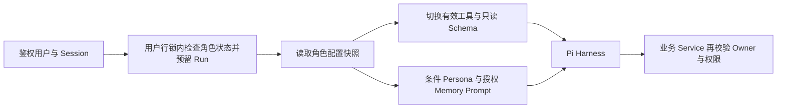

# Fanto 服务端多角色 / Owner / Memory / Session 实施方案

更新：2026-10-21。最终需求覆盖先前含 deleted/deleted_at、可重绑定 Session 的草案。范围仅 apps/server 和对应 plan/docs/服务端 AGENTS；保留客户端及其他未提交工作，不提交推送，不操作实际数据库。

## 数据与不变量

- user_fantos：UUID 身份、非唯一 user_id、nullable 输入规范为空串的 nickname/description/四段 role_config、独立 agent_config、active/archived、archived_at、version、时间。身份创建后固定；无 deleted/deleted_at/session_id。
- 同用户最多 3 active，由应用常量 MAX_ACTIVE_FANTOS 控制。创建与恢复在用户行锁内检查数量；归档不占名额。
- agent_config：recordReadEnabled/userMemoryEnabled/narrationEnabled，默认 false，拒绝未知字段，PATCH 子键合并。
- Records/Memories：owner_type=user|fanto + owner_id。现有 Record API/后置处理/Embedding 仅 User Owner；不新增 Fanto 世界记录创建功能。媒体始终以实际 userId 验证。
- User Memory：personal_background/important_relationships/current_focus/interaction_preferences；Fanto Memory：shared_history/relationship_state/ongoing_threads/personal_experiences。DB 与 Service 双重校验，Owner 容量和并发写入隔离。
- 全部业务表无 SQL 外键；主键、唯一、CHECK、索引保留。没有 SQL cascade，不承诺裸删 users 可以完成账户清理。当前没有账户物理删除 API；本期不新增账户销毁产品入口。
- main 类型不变；sessions.scope_key=default 或 fantoId，以 (user_id,agent_id,scope_key) 对 main 唯一。Fanto 创建事务初始化独立 Session，默认 Main 首次幂等初始化。角色表不持久化会话指针。

## 运行链路

默认 Main 的 agent.yaml 工具为 record_read/user_memory_manage/present_media；Runtime 额外注册 fanto_memory_manage。Fanto 始终激活自己的 Memory 和 present_media，按开关启用 User Record/User Memory；UserMemoryTool 在角色模式只暴露 list/search，写入守卫独立拒绝伪造动作。工具不接收身份参数。

MainDynamicProvider 省略空身份段、按开关输出 Record/Memory/Narration 指南。无角色不扮演虚构人物。User Memory 仅背景与偏好默认注入，其他由工具按需检索；Fanto Memory 仅当前角色，每 Scope 12000 字节预算。删除 recent_records 的运行入口，不自动读 Record。

同一角色运行中 PATCH 配置/归档/删除均返回 FANTO_BUSY，确保本轮权限不变化。Run 预留与生命周期操作争同一用户行锁。当前运行状态是单进程内存门禁，多实例上线前必须另行引入分布式运行租约。

## 生命周期和物理删除

归档保留所有角色数据，阻断新 Run；恢复复用原 Session，检查名额。History/Stop 按 Session 所有权可用。

DELETE 在锁内检查版本、归属和空闲，先排空并驱逐 Session/Checkpoint，再在一个事务中删除 entries/usage/sessions、Fanto Owner Records/Memories、独占媒体元数据和角色行。保留 User 数据、其他 Fanto 与默认 Main。迟到 Checkpoint 无父 Session 时拒绝写入。

外部对象不能与数据库原子提交：同事务将独占对象 key 写入 fanto_media_deletions，提交后执行存储删除。无角色墓碑。对象成功删除才返回 204；失败返回 202 pending。相同用户以同 fantoId 重试 DELETE 继续清理；pending 时不比较已不存在角色的版本。其他用户 404；清单完成后再次请求 404。数据库失败整体回滚；没有自动后台对象清理保证。

## HTTP

| 方法 | 路径 | 契约 |
| --- | --- | --- |
| GET | /api/fantos | includeArchived=true 可含归档 |
| POST | /api/fanto | 创建身份和固定 Session，201 |
| GET | /api/fanto?fantoId=UUID | 本人详情 |
| PATCH | /api/fanto | fantoId/expectedVersion/changes，仅读写能力与头像 |
| POST | /api/fanto/archive 或 restore | fantoId/expectedVersion |
| DELETE | /api/fanto?fantoId=UUID | If-Match 版本，204 或 202 pending |
| GET | /api/agent/main-session | 幂等默认 Main |
| POST | /api/agent/sessions | 403，禁任意创建 |

旧 Character PUT 返回 409；旧设置写入口不再开放，不能绕过固定身份和 Session 约束。H5/iOS 的后续适配不在本次范围。

## 迁移与验证

当前基线只面向新空库，可幂等重放当前结构，不自动升级旧业务数据。用户已手动清空库表，迁移合并为 create_current_schema_20261019.ts 单一基线，移除历史空迁移和独立校验迁移。用户运行 pnpm db:migrate 重建；需同时清除旧 Kysely 迁移元数据。脚本不 DROP/TRUNCATE 实际业务库，本次不代执行实际数据库迁移。

验收覆盖：并发活跃上限/恢复、固定身份和 Session、版本冲突、默认 Main 三工具、只读 User Memory、跨 Owner 防护、禁用 Record 与媒体越权、条件 Prompt/预算、运行门禁、删除排空/迟到写入、存储故障重试、无外键与冷恢复。

执行入口：Server typecheck、Server 全量 test（本机独立 PostgreSQL+vector 测试实例），真实模型与对象存储 smoke 独立配置。任务记录见同目录的 tasks 文件；当前系统事实以 docs 与代码为准。
