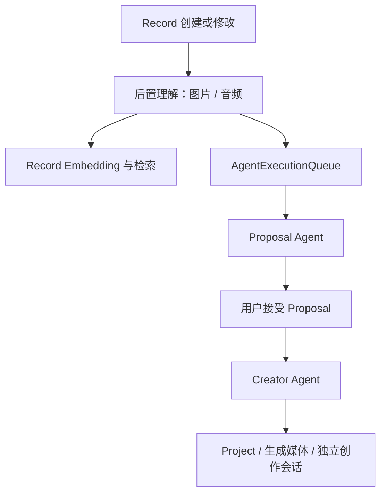
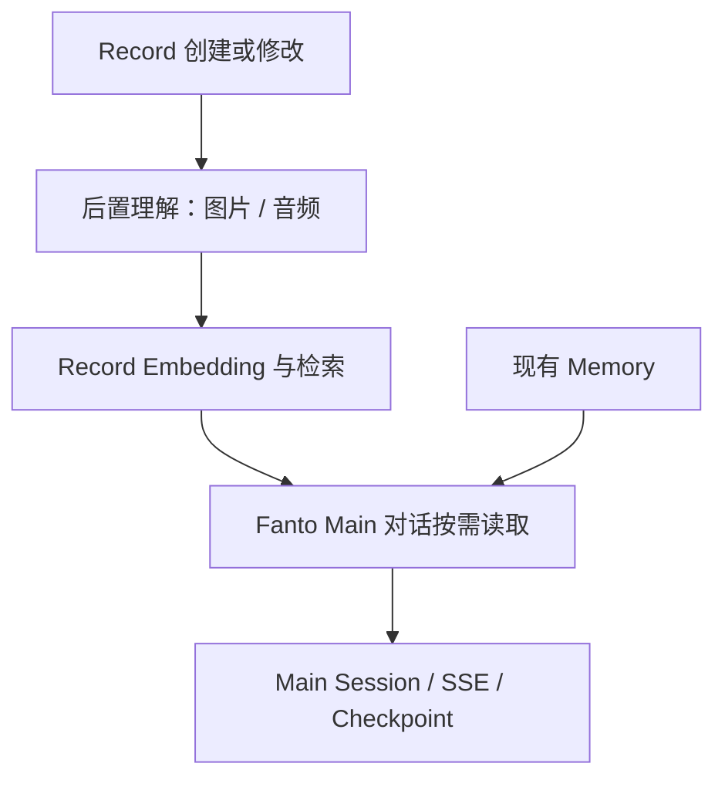

# Projects / Proposals 完整清理方案

日期：2026-10-20。调研基于当前工作区与 HEAD `011d892`；本文是待执行方案，不代表已清理。实施前复查最新 diff，保留其他任务的修改。本次只新增本方案与任务文件，不修改业务代码或运行数据库。

## 1. 目标与边界

彻底移除 Projects / Proposals 的产品能力、运行入口、Agent 定义、工具、Prompt、上下文、后台执行、API、专用领域及数据结构、客户端实现和配置。不是隐藏页面、关闭开关，也不保留空壳 Service、永远关闭的后台 Handler 或替代性的创作模块。

最终保留：用户认证与身份联系方式、用户 / Fanto 资料、Record（文字 / 图片 / 音频 / 地点）、记录图片理解 / 音频转写、Record Embedding 与检索、现有 Memory、Fanto Main 对话、媒体上传 / 读取 / 缓存、Admin 的用户 / Main 会话 / Usage 查询。保留当前主对话的停止、恢复、消息分页、工具展示及设置清除后绑定新 Session 的语义。

不借此新增 Agent、任务系统、绘图入口或新架构，不重新设计已有 UI；不批量清空用户、Records、Memory 或全部 Agent Session。会话列表等通用能力不因名称接近而自动纳入本次删除。

## 2. 已验证的依赖与当前行为

1. `apps/server/src/bootstrap/main.ts` 无条件装配 ProjectService / ProposalService；`CREATIVE_ENABLED` 控制 CreativeService 和 Handler，但不是所有 Project / Proposal API 的总开关。H5 仍有 `/projects` 路由和“脉络”入口，iOS 虽隐藏入口，模型 / Store / 网络与页面代码仍存在。
2. `listeners/record-postprocess.listener.ts` 在 Record 处理成功后同时发布 Embedding 与 Proposal 消息。`event/agent-execution-queue.ts` 只有 proposal / creator 两类消息，`execution/` 的 Worker、Listener、两个 Handler 均服务于此链路。
3. `agent.yaml` 同时定义 main、proposal-agent、creator-agent；`definition.ts`、工具注册、Context Provider、BusinessServices、RunMetadata 和日志都包含创作分支。五个服务端 Skill 包只配置给 Proposal / Creator。
4. `routes/projects.ts` 注册 Project 列表 / 详情 / PATCH / archive，以及 Proposal 列表 / 详情 / records / accept / reject。公开 Agent Stream 还接受 `metadata.projectId`，领域内校验 userId + projectId + sessionId。
5. RecordService 和 RecordRetrievalService 的工厂直接依赖 `ProjectService.removeRecordReferences`；Record Repository 删除时调用关联清理回调。不能只删除领域目录，否则记录检索 / 删除都会受影响。
6. MediaService 混合了通用上传、头像和 Record 媒体，以及 Project 生图、最终引用复制和临时参考图逻辑。`image-client.ts` 同时包含必须保留的图片理解和可删除的创作生成 / 审查 / 下载。
7. `SessionEventBus` 的生产发布方是 `AgentWorker`；只读 `/sessions/:id/events` 和客户端订阅用于后台 Creator。Main 使用 POST Stream 自带 SSE，不依赖这条订阅。
8. 数据库存在 `projects`、`proposals`、`record_links` 及关联索引；Agent 历史共用 `agent_session.sessions / entries / usage_ledger`；生成媒体位于 `users/<userId>/project/<projectId>/...`，元数据包含 source / projectId。
9. iOS 主对话直接复用 `Projects/MarkdownContentView.swift`。该文件还混有 Project 命名的图片组件与 HTML Preview 分支，不能整目录直接删除。`projectHistory()`、`ConversationStore.project()` 和 `FantoService.projectRole()` 的 project 是“投影”，与业务 Project 无关。
10. `records.task_id` 是后置处理 runId 的认领令牌，防止旧版本结果回写，不是待删除的 Project / Task 模块字段。

### 当前链路

### 清理后链路

## 3. Server 清理

### 3.1 断开装配与触发

- `bootstrap/main.ts` 删除 ProjectService、ProposalService、CreativeService、CreativeImageClient、AgentExecutionQueue、AgentWorker、Handler 和 Listener 的创建、启动修复 `normalizeLegacyMedia()` 以及 shutdown 等待。
- `bootstrap/app.ts` 的 ServerServices 移除 projects、proposals、creative、agentQueue、agentWorker；删除专用 routes 注册和 `/api/projects/*` 13 MiB bodyLimit。通用认证、健康、Record / Media / 用户 / Fanto / Admin 不变。
- `record-postprocess.listener.ts` 删除 AgentExecutionQueue 参数和 proposal publish，只发布 Embedding。保持 claim / complete / release、版本保护、单素材失败处理和用户隔离。
- 删除 `src/execution/` 与 `event/agent-execution-queue.ts`。保留 RecordPostprocessQueue、RecordEmbeddingQueue 及各自 Listener。

### 3.2 删除领域与 API

- 删除 `domain/projects/` 全目录、`routes/projects.ts`、专属 `routes/project-http.test.ts`。
- 删除 `/api/projects*`、`/api/proposals*` 全部业务接口，使用现有路由未匹配行为，不保留兼容写入口或废弃业务 DTO。
- 改造 `RecordService.create()`、`RecordRetrievalService.create()`、`PostgresRecordRepository`，移除 Project import 和 cleanupLinks 回调 / 调用。若 RecordSavedHook 没有剩余调用者，一并移除对应空插槽；不要用 no-op 假依赖代替。
- 保留 Record 删除的事务、用户 / version 校验、Record 独占媒体元数据清理与提交后对象存储删除。

## 4. Agent 清理

- `agent.yaml` 删除 proposal-agent / creator-agent；默认仅保留当前 main 与其三项工具。删去仅为 Creator 配置且不再引用的模型项，不调整 Main 模型。
- 删除 `prompts/proposal-agent.ts`、`prompts/creator-agent.ts`、`tools/creative.ts`、`context/providers/proposal-context.ts`、`creator-context.ts`。
- `harness/definition.ts` 删除两种 Prompt Module、五项创作 Tool 枚举及专属权限 / Skill 交叉校验；旧配置若仍声明这些能力必须校验失败，不静默忽略。
- `tools/index.ts`、`context/providers/index.ts`、`agent-runtime.ts`、`business-services.ts` 去掉创作依赖、可选接口与调用分支。readRecords 回到现有用户隔离的 RecordService 路径。
- 删除 proposal_create 成功后终止 Run 的 Hook；保留通用停止和已有工具语义。清理 RunMetadata、RunContext、工具上下文与日志中的 projectId、proposalId、仅用于后台创作的 recordId / recordVersion；逐项验证剩余消费者，不删除通用 userId / sessionId / runId / traceId / timeZone / sourceMessageId。
- `routes/agent/schemas.ts`、Stream 和客户端请求体移除 `metadata.projectId`。旧 projectId 请求应通过严格校验拒绝；若 metadata 已无合法字段则移除该空壳，而不是留下任意 metadata 对象。
- 删除服务端五个创作 Skill 包：creative-opportunity、aesthetic-judgment、artistic-thinking、intellectual-depth、emotional-nuance 及其专用 references。这里不是删除仓库 `.agents/skills` 或用户安装的开发 Skill。
- 保留可独立使用的 Registry、Pi Harness、SkillLoader、workspace 基础设施，以及通用工具实现；不因当前 Main 未启用某能力而扩大成整套 Runtime 重写。不向 Main 开放新的 bash、文件或创作权限。

### 只读 Events 的退场

当前生产发布方仅为后台 AgentWorker，移除后不留“永远没有事件”的接口：删除 `event/session-event-bus.ts`、ServerServices.events、`GET /api/agent/sessions/:id/events`、专属测试及 iOS observeSession / H5 订阅客户端。

保留 `POST /api/agent/stream` 的直接 SSE、`GET .../:id/history`、停止及 Session 创建。不要删除共享 `writeStreamEvent()`、waitForOutput / run-output 等 Stream 仍使用的函数。

## 5. 媒体与基础设施

- MediaService 删除 `createGeneratedImage`、`copyFinalReferences`、`cleanupUncommittedProjectObjects`、`withGenerationReferences` 及仅服务这些路径的辅助函数。
- `image-client.ts` 保留 ImageUnderstanding.describe 和 QwenImageUnderstanding 的图片理解；删除专用 review 能力、ImageGenerationClient、CreativeImageClient、恢复 token 加解密、生成结果下载和仅由这些方法使用的错误 / 辅助类型。
- 不删除 `sharp`：Record 图片缩略图和头像校验仍需要。不删除通用 OSS / R2 Client、媒体 ID / variant 读取、原图 / 缩略图签名、媒体上传与引用校验、头像用途隔离。
- 更新媒体、外部调用日志和 R2 集成测试，删除创作专属部分，同时保留并运行通用上传、缩略图、图片理解、音频、删除与用户隔离断言。

## 6. 数据库与旧数据

### 最终结构

移除 `projects`、`proposals`、`record_links` 的 DB 类型、SQL 建表和专属索引。最终仍有 users / identities / challenges、records、media_assets、memories、user_fanto_settings、user_profiles 与 Agent Checkpoint 三表。

### 两条安装路径

1. **空库**：当前基线不再创建三张退役表；更新空库表清单测试。
2. **已有库**：不能假定此前重置尚未执行，也不要求再清全库。新增单向退场迁移，按 `record_links → proposals → projects` 执行 `DROP TABLE IF EXISTS`；不使用无边界 `CASCADE`。在隔离库验证重复执行和用户 / 记录 / 记忆 / 资料保留。

修改基线仅解决新安装，不能代替已有库退场。不要删除 Kysely 历史来强行升级。实施前核对迁移目录的最新有序命名及依赖，不依赖本文猜测线上迁移状态。

### 历史会话与媒体处置

- 删除代码不等于清空所有历史文件；退场前输出仅含退役数据 ID / 对象键 / 数量的维护清单，避免把正常用户数据归入清理范围。
- 若执行完整历史清理，仅按精确 agent_id `proposal-agent` / `creator-agent` 选择 Session，依次处理它们的 Entries、Usage 和 Session 行；保留所有 Main Session、消息和 Usage。同步检查并处理异常指向这些退役 Session 的 Fanto 指针。Admin 历史总用量可能随退役 Usage 删除而减少，须在清单中明确，不能声称统计完全不变。
- 清理 Session 需依据已查询的 userId / sessionId 列表；禁止按“不是 main”或目录名称模糊匹配批量删除未知 Agent 数据。
- Project 专属媒体需在丢失业务表关联前形成候选清单，并校验 `source=project`、精确 projectId / userId 与对象键归属。Record 原图、用户 / Fanto 头像与背景图不在候选范围。
- Main 历史可能展示曾经生成的图片，专属来源不等于未引用。只有确认不被保留的 Record、资料、Main 消息 / 媒体展示引用后，才在一次性维护操作中删除媒体元数据和对象。不能可靠证明独占则保留并报告；不在启动或 migration 中进行 OSS 批量删除，不把“删库成功”当成远端文件也已删除。
- Session 工作目录同样按退役 Session 清单定向处理，保留 Main 工作目录和现有对话文件。历史外部文件维护清理与代码发布分别报告，应用中不新增常驻清理队列或新的 Project 兼容层。

## 7. 客户端与 Shared

### iOS

- 先把主对话复用的 MarkdownContentView 及图片渲染能力迁到 Conversation / 通用 UI 位置；改掉其中 Project 命名的图片类型，移除只用于 Project 的 HTML Preview 分支。保留 Main Markdown、媒体缩略图 / 原图预览、链接安全边界。
- 再删除 `Projects/` 专用页面和 `Models/Project.swift`，FantoStore 的 projects / proposals / LoadState / 请求标识 / 操作方法与 init 参数，以及 FantoAPIClient 的专用请求、Payload / Page / DTO。
- AgentAPIClient 移除 projectID metadata 和只读 Events。Root / Preview / 退出重置中的残留逐项更新。保留 Records、草稿、统计、资料、缓存与三个主 Tab，不借此调整其他 UI。
- 核查 Xcode 自动目录同步 / 资源引用；只移除确认为项目功能独占的资源，不按 `Creating` 或 `Project` 名称盲删。

### H5

- 删除 ProjectsPage、api/projects.ts、components/projects/，移除 App 路由及 AppShell“脉络”导航；旧 `/projects` 走现有未知地址回到 Records 的行为。
- 清理专用样式、projectId 请求 metadata、后台事件订阅及测试。保留 Main Chat 的 Markdown、MediaPresentation、历史恢复和停止。

### Shared

当前 Project / Proposal DTO 主要分别定义在各端，并非 packages/shared 的现成领域包。审计并移除无剩余调用方的旧 TopicDto / models/topic / TOPIC_STATUS 及导出（旧“脉络”遗留）；保留 Record DTO、RecordContent、状态常量和通用 API response。`projectHistory`、`projectRole`、路径 projectRoot / Xcode project 均不能按关键词误删。

## 8. 配置、文档与依赖

删除 AppConfig 与 `.env.example` 中的 `CREATIVE_ENABLED`、`CREATIVE_PROPOSAL_TIMEOUT_MS`、`CREATIVE_CREATOR_TIMEOUT_MS`、`CREATIVE_IMAGE_ENDPOINT`、`CREATIVE_IMAGE_API_KEY`、`CREATIVE_IMAGE_MODEL`、`CREATIVE_IMAGE_TIMEOUT_MS` 和 `AGENT_EXECUTION_CONCURRENCY`；仅清理被跟踪模板 / 读取代码，不擅自改真实环境密钥。

复查 deploy / setup 脚本，不保留后台创作专属的启动要求。只在包依赖确无剩余消费者时移除并更新 lockfile；不能为了删除生图顺手删除仍支撑图片处理、Swift Markdown、Main 或存储的库。

实施后删除或合并 `docs/domain/projects.md`、`docs/architecture/creative-runtime.md`，同步 README、根 / Server / iOS AGENTS、overview、server、agent-runtime、http-api、product/current-scope、客户端、Media / Records、configuration / testing / local-development 等引用。保留现有 Memory、角色和认证最新语义，不照旧文档覆盖新实现。本轮不是全量文档刷新，不推进 docs/.checkpoint；若后续明确做全量刷新，再按仓库 checkpoint 规则审查。

## 9. 验收标准

1. Main 启动、登录恢复、发消息、Record / Memory 工具、媒体展示、断线 / 后台恢复、停止 / 续聊、向上分页、设置清除后新 Session 均正常。
2. 新 Record 仍完成图片理解 / 音频转写与 Embedding，触发链路不再提交后台 Agent Run。Record 删除不查询 record_links 或 Project，媒体事务仍正确。
3. 已认证访问旧 Project / Proposal / Events 路由返回未匹配；旧 Agent ID 创建返回不可用；携带 projectId 的 Stream 请求严格拒绝。
4. 空库与已有最终基线库两条路径都得到无退役三表的最终结构；重复迁移无错误，不改动正常用户、Records、Memory、资料及 Main 会话。历史清理若执行，按清单验证影响范围。
5. iOS / H5 无专属页面、路由、Store、DTO、网络调用或死样式；Main Markdown 图片展示和 Record 草稿 / 缓存不受影响。
6. 全局审计不再存在可执行的 Project / Proposal 领域导入、工具、Provider、队列、配置或调用；遗留迁移中的退役名称是必要的历史例外，正常的 project 投影函数 / Xcode 名称不是残留业务。

验证入口：`pnpm typecheck`、`pnpm test`、`pnpm --filter @fanto/h5 build`；配置隔离 TEST_DATABASE_URL 执行数据库 / 记录 / 媒体 / Memory / Auth / Checkpoint 集成测试；iOS 模拟器 SDK 编译以及既有缓存 / 地点测试。真实付费模型、OSS 删除、部署和真机交互单独说明，不能把 Mock / 构建当成真实验收。

## 10. 发布顺序

先完成一个整体可编译版本与隔离库验证，再停止旧 Server，阻断旧客户端写入，完成退役数据清单及必要导出；执行已有库退场迁移，启动新 Server 并发布 H5 / iOS。不能让旧 Server 在三表已删除后继续运行。任何历史 Session / 文件维护清理在有清单后单独执行，不在常规启动自动执行。

此变更移除功能且数据库退场不可逆；代码回滚不恢复已删除业务数据，恢复依赖执行前的数据库 / 文件备份。只做新空库部署时无需执行历史资源清理。
