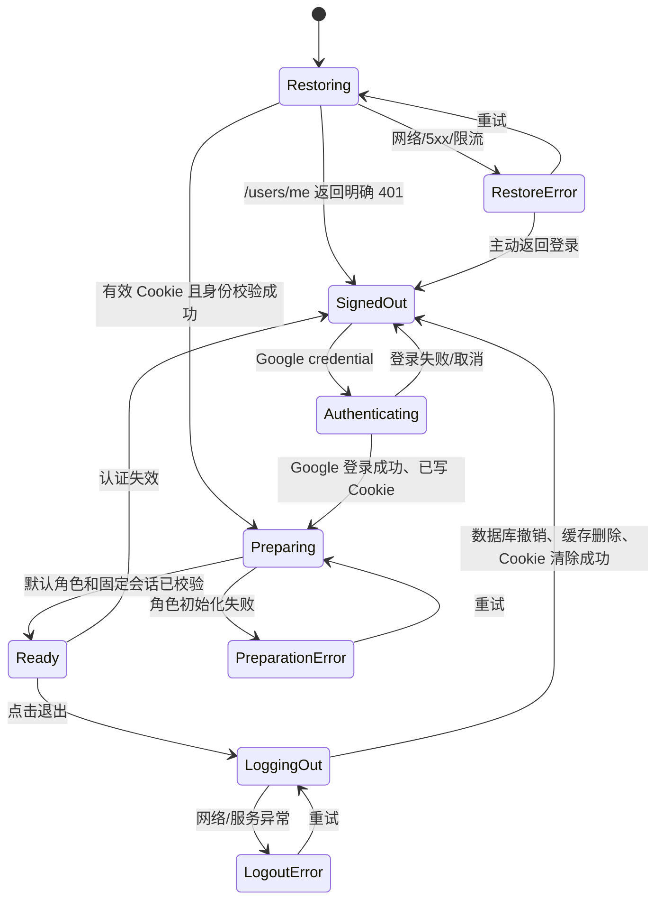
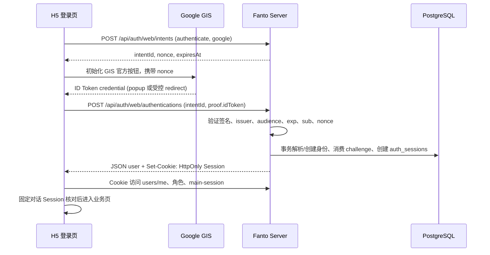
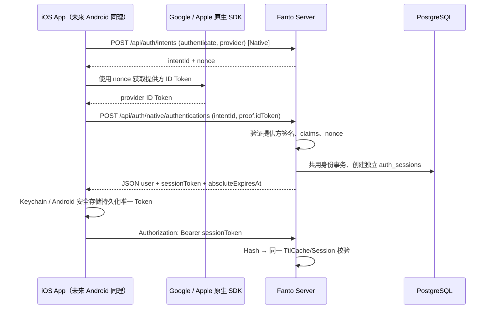

> 2026-10-22 执行决定：**Server 不保留任何旧 JWT/Refresh 兼容**，直接启用单 Token Session。旧版 iOS 必须升级并重新登录；原方案中的灰度 JWT 兼容窗口、旧协议保留与延期收口均不执行。生产部署需与新版客户端同步安排。

# Fanto 全平台统一单 Token Session 与 H5 Google 登录方案

日期：2026-10-22。状态：**代码改造与自动测试已完成；生产部署、Google Cloud 来源验证、真机 OAuth 与独立 PG 集成测试尚待验收**。Server 不设 JWT 兼容窗口。

本次修订：**H5 / iOS / 未来 Android 全平台统一不透明单 Token Session**，使用同一张 `auth_sessions` 表、同一套验证/撤销和 24 小时进程内热点缓存；差异仅在凭证的客户端保存与传输方式：**H5=HttpOnly Cookie，iOS=Keychain + Bearer，未来 Android=Keystore 支持的安全存储 + Bearer**。每次设备登录独立生成一个 Token，不共享跨设备凭证，不使用独立 Access/Refresh Token，也不轮换。既有 iOS JWT 双 Token 被直接替换，旧 JWT API 不保留兼容。

本期仍只针对单进程实现热点缓存和撤销，复杂并发与多实例分布式缓存未来再做。仅更新方案与任务，不修改代码、env 或 Current State 文档。

## 1. 结论与已验证现状

可以复用 Server 的 `GoogleIdentityProvider`、`AppleIdentityProvider`、`AuthService` 和现有 `users`/`user_login_identities`；保持 Google `sub` 稳定识别身份、新用户创建默认 Fanto、challenge 10 分钟/一次性消费的规则，不以邮箱合并用户。

- H5 目前尚未正式登录：`main.tsx` 通过 `initializeTestSession` 恢复测试 JWT；API/SSE 依赖 `auth/test-session.ts`。需要彻底移除构建时 Refresh 凭证和正式 H5 对 JWT 的依赖。
- **iOS 当前尚未统一**：`AuthAPIClient.swift` 的 `/api/auth/authentications` 返回 Access JWT + Refresh JWT；`AuthSession.swift` 管理到期刷新；`AuthCredentialStore.swift` 以 Keychain 保存双 Token；四个原生业务 API Client 通过 `AuthSession.shared.accessToken()` 填入 Bearer；`AuthenticationStore.signOut()` 当前只清本地，没有 Server 撤销。实施时需逐一替换。
- 服务端当前 `JwtTokenService` 在 `AuthService` 中签发 JWT；现有 `/api/auth/tokens/refresh` 与 JWT Bearer 中间件属于**待迁移的旧链路**，直接删除，不允许过渡兼容（见 6.7）。
- Server 已有 `infrastructure/cache/ttl-cache.ts`，支持 TTL、容量限制和删除，可供 Session 复用。PM2 配置 `instances: 1`、`exec_mode: fork`，本地缓存撤销仅能覆盖当前单实例；未来多实例才引入分布式缓存。
- H5 `FantoProvider` 仍负责校验默认角色与固定对话 Session；登录身份初始化与业务准备分离。**认证 Session 与 Agent 对话 Session 是不同数据模型。**
- Google Cloud 截图曾展示 Web OAuth Client 和 `https://fanto.robinverse.me` 来源，不代表配置已经保存或线上已验收；实施时核对生产/localhost 与 Audience。
- H5 登录视觉继续参考 iOS `AuthenticationEntryView`、`LoginBackground`、`StartupExperienceView` 中的品牌精灵、渐变和标语。

## 2. 产品范围、跨端模型与取舍

交付：H5 正式 Google 登录/注册、品牌启动页、Cookie 恢复和退出；**同步改造 iOS 原生 Google/Apple 登录、存储、请求鉴权、恢复与退出**；Server 统一 Session 签发、Hash 校验、热点缓存、有效期和撤销；设计上兼容未来 Android，但本期不新增 Android 工程。

| 客户端 | 唯一 Session Token 保存位置 | 业务请求传输 | 登录身份提供方 | 恢复 / 退出 |
| --- | --- | --- | --- | --- |
| H5（含移动浏览器/PWA） | `__Host-fanto-session` HttpOnly Cookie | 浏览器同源自动携带 Cookie | Google GIS | `GET /api/users/me`；Web logout 清 Cookie + 服务端撤销 |
| iOS 原生 App | Keychain（仅存 Session 原文和必要用户元数据） | `Authorization: Bearer <sessionToken>` | 现有 Google / Apple SDK | Bearer `GET /api/users/me`；Native logout + 清 Keychain |
| Android 原生 App（未来） | Android Keystore 支持的加密存储 | `Authorization: Bearer <sessionToken>` | 未来选定的原生登录 SDK | Bearer 恢复；Native logout + 清安全存储 |

**统一的含义是每台设备使用同样格式、同一验证服务和同一数据库，而非跨设备共用同一个 Token。**每次认证创建独立 Session，同一用户允许多 Session；退出只撤销本次登录的 Session，不影响其他设备或浏览器。

不做：BFF、Access/Refresh 双 Token、客户端刷新调度、Token 轮换/重放检测、Web Access JWT、Redis、设备列表、远程踢下线、全部设备退出、匿名账号、H5 Apple/手机号登录或新 Android App。本期只建 `auth_sessions` 一张表，不建 `auth_refresh_tokens`，也不为了可能的设备列表采集设备指纹。保留简化的 `client_type=web/native` 由服务端可信入口填写，仅用于传输通道约束与运维，**不**作为账号身份或设备指纹。iOS 和未来 Android 都属于 `native`，不按操作系统拆成不同 Token 体系。

全局 Session 采用 7 天不活跃过期、30 天绝对截止。超过期限客户端需重新完成 Google/Apple 身份登录；没有 Refresh Token。单实例内存缓存最长 24 小时，服务端撤销后删除本地缓存；当前不承诺并发中的旧缓存读取、已经开始的 API/Agent SSE 立即中断。

## 3. 页面与视觉

### 未登录首页

- 它是应用入口页，不做长营销页面。沿用 iOS 的背景、精灵和标语，移动端纵向排列，桌面端仍用居中单列，无边框登录大卡片。
- 唯一主操作：Google 官方按钮。次级内容：登录错误与重试。三级内容：协议与隐私链接。没有 Apple、游客体验或独立注册按钮；首次 Google 登录自动创建账号。
- 初始布局：内容宽度 `min(100% - 48px, 400px)`；移动端精灵约 156px，标语约 20px/600，图文间距 24px；Google 按钮宽度以 320–360px 为目标且不超容器，位于下半区，具体外观和尺寸以 GIS 官方组件允许值为准。错误区保留空间，防止按钮跳动。底部说明约 12–14px，保证实测对比度。
- 背景源自 iOS：浅色 `rgb(209,232,252)` 到 `rgb(255,247,230)`；认证页变量限定在自身容器，不改变聊天全局主题。首期浅色与现有 H5 一致；不单独让登录页跟随系统变暗而聊天仍是浅色。
- 复用 iOS 的 FantoLoginSprite 与 FantoStartupSprite 原始资源，实施时导出到 H5 自身 assets，固定图片宽高并优化体积，不从 Swift 源路径运行时加载。不重新生图，不使用用户头像代替品牌素材。
- `100dvh`、安全区 padding、小高度可滚动；验证 375px、390px、1280px。键盘焦点可见；状态使用 aria-live。只用短淡入，支持 reduced-motion，无强制播放或最低等待时间。
- 协议与隐私目标沿用 `/terms`、`/privacy` 的约定，但当前文档说内容尚待发布；正式公开前必须落实可访问内容及路由，不能把登录首页重定向当作协议页面。未有实际内容时不展示伪链接或宣称用户同意了不可阅读的条款。

### 品牌启动页

全屏同一渐变、居中启动精灵（约 180–210px）和同一标语。启动恢复与首次角色准备复用一个稳定实例，不重复播放入场。短等待只显示品牌；约 1 秒后显示真实状态“正在恢复登录…”或“正在准备你的 Fanto…”。没有假进度条。

身份恢复与首次角色 API 设定请求超时（建议 15 秒），失败立即进入可操作错误状态：“暂时无法连接”，主操作“重试”，次级“返回登录”。保留有效身份；只有明确认证失效才自动返回未登录页。头像、历史消息和外部模型不作为全局启动完成条件，交给聊天页原有加载/失败状态。

H5 没有 iOS 的业务快照体系，不为了复制启动体验新增缓存系统。H5 首次只等待已有默认角色与固定 Session 的必要校验，后续刷新不重新遮住整个应用。

## 4. 导航与状态

`main.tsx` 立即挂载 Router 与 AuthProvider，不在 React 挂载前等待网络。`/` 为未登录首页；已登录访问 `/` 跳转 `/chat`。业务路由受 AuthGate 保护，允许的站内深链在登录后恢复，`returnTo` 禁止外部 URL。Cookie 不可由 JS 读取，因此启动用 `GET /api/users/me` 认证并恢复用户状态，**不再调用 Refresh**。



身份确认后才挂载 FantoProvider，首次角色准备成功后才挂载 ChatPage；已登录期间后续角色刷新保持原页面，不使用全屏遮挡。认证失败与网络不可达需要区别提示，不因网络问题擅自认为已登出。

## 5. H5 Google 与原生登录链路

默认采用 Google Identity Services（GIS）官方按钮，使用 Google ID Token + Server challenge nonce，不涉及 Client Secret。支持 popup callback 的浏览器走弹窗；**iOS Safari 作为明确验收目标**，在目标环境 popup 不可用时使用 GIS 支持的 redirect 模式，实施时为 redirect 表单回调单独设计请求格式和防 login CSRF/浏览器关联校验（不能假设它能带 JSON 与自定义头），并做真实浏览器验收。不要直接让未经验证的 redirect 回调创建 Session。



- SDK 加载去重；按钮可用前先取得未过期的 intent/nonce；登录尝试应一次消费，React 重渲染不得错误复用 nonce。取消/超时可创建新 intent，认证结果未知时不重发可能已消费的 proof。
- Web intent 在服务端标记可信的 `delivery=web`，只能由 Web 入口兑换 Cookie；iOS/未来 Android 的 intent 使用可信 `delivery=native`，由原生 Session 登录接口兑换 JSON Session Token，防止跨通道混用。
- Web 与 Native 统一复用身份解析、默认 Fanto 创建、challenge 消费和 Session 创建事务；同一个已验证的身份对应已有 `userId`，不能因为客户端不同创建第二个用户。不能先签旧 JWT 再包装 Session。
- `VITE_GOOGLE_CLIENT_ID` 指向已有或新建的 Google Web Client ID。Server `GOOGLE_ALLOWED_CLIENT_IDS` 加入对应 audience 并保留 iOS 所需 ID。新增精确 `AUTH_WEB_ORIGIN`；验证 Google Cloud 真实授权来源、测试用户/发布状态及 localhost 开发来源，不假设截图设置已保存。
- 移除 `VITE_H5_TEST_AUTH` / `VITE_H5_TEST_REFRESH_TOKEN` 正式入口，清理 `fanto.h5.test-auth.tokens`，不将历史测试用户 Session 迁移为公开身份。H5 `.env.example` 只放公开 Client ID 占位符，不放服务端密钥。
- Nginx 沿用同源 HTTPS `/api` 代理；需要检查 CSP/COOP/FedCM 与 GIS 弹窗/重定向兼容性，避免盲目添加不兼容响应头。

### 5.1 iOS / 未来 Android 原生执行过程



- 原生打开/冷启动：从安全存储读取 Session Token，调用带 Bearer 的 `GET /api/users/me` 向 Server 验证；只有 200 才恢复已认证状态。无网时保持可重试状态，不把网络故障当成凭证被撤销；401 则清理本地旧 Token、显示登录入口。
- 原生前后台切换、普通请求均重复携带**同一个** Session Token，不再调用 `/api/auth/tokens/refresh`，不会因 Access JWT 30 分钟到期而重新刷新。只有服务端 Session 到期/撤销后才重新登录；服务端续空闲期不会改变 Token 原文。
- 退出登录：原生 `POST /api/auth/native/logout` 携带 Bearer，Server 撤销该 Session 并删除缓存，原生确认成功后删除 Keychain/安全存储。该退出路由自行按 Token Hash 定位并可重复撤销，即使已撤销而通用鉴权会拒绝，也应幂等清理，不能依赖先通过业务鉴权。失败时禁用继续请求并提示可重试；不能把纯本地删除伪装成服务端撤销完成。
- iOS 原生 Google/Apple 登录 Provider 验证机制不变，只替换认证凭证签发/保存/发送与登出；Android 是将来消费**同一服务端 Session 契约**，不在本次新增客户端代码。

## 6. 全平台统一 Session、热点缓存与安全边界

### 6.1 Session Token、数据结构与生命周期

- 所有客户端登录成功均使用**至少 32 字节 CSPRNG 随机数**生成不透明 `sessionToken`；Server 只存其 SHA-256 摘要 `token_hash`。**每次设备登录是独立 Token**；相同原文经过 Hash 在 H5、iOS、Android 的认证服务中走完全相同的校验链路。不是 JWT，不包含客户端可解码的用户信息，不签发 Access/Refresh 双 Token。
- **H5**：成功响应通过 `Set-Cookie` 写 `__Host-fanto-session`，设置 `HttpOnly; Secure; SameSite=Lax; Path=/` 且无 `Domain`；JSON **绝不返回** `sessionToken`。Cookie 按最长 30 天有效期设置，服务端仍强制校验空闲截止；退出用同名和同 Path 清 Cookie。浏览器 JS 无法直接读取凭证。
- **iOS / Android**：JSON 返回 `{ user, sessionToken, idleExpiresAt, absoluteExpiresAt }`（无 Refresh）；App 保存到 Keychain/安全存储，业务请求用 `Authorization: Bearer <sessionToken>`。不得将 Token 写入普通偏好设置、日志、URL、剪贴板或明文存储。
- 生命周期统一：7 天空闲失效、30 天绝对上限，`idle_expires_at = min(last_seen_at + 7 天, absolute_expires_at)`；**实际有效性以 Server 为准**，缓存命中也必须检查两个截止时间。可使用 `AUTH_SESSION_IDLE_TTL_SECONDS=604800`、`AUTH_SESSION_MAX_TTL_SECONDS=2592000`，不再分 Web/native Session TTL。
- 为减轻写库：缓存未命中但 Session 有效时，可更新数据库 `last_seen_at` 与 `idle_expires_at`；命中缓存只读，不刷新数据库或 Token。H5 初次设置的 Cookie 可保留到最长 30 天，服务端 7 天空闲过期后仍会拒绝该 Cookie，避免所有 API 响应都轮换 Cookie；Native 原 Token 无需重签发。需要兼顾真正持续活跃的用户，在缓存 TTL 到期后续约。客户端过期只能重新验证身份登录。

新增一张前向迁移表（当前迁移 001–003，实施前确定下一编号，暂定 `004_create_auth_sessions.ts`）：

| 表 | 字段与约束 |
| --- | --- |
| `auth_sessions` | `session_id UUID PK`、`token_hash CHAR(64) NOT NULL UNIQUE`、`user_id TEXT NOT NULL FK users(user_id)`、`client_type TEXT NOT NULL CHECK IN ('web','native')`（由 Web/Native 服务端认证入口赋值）、`created_at`、`last_seen_at`、`idle_expires_at`、`absolute_expires_at`、`revoked_at NULLABLE`；按用户及过期清理所需索引 |

同一用户可同时有多个同类型或不同类型 Session；`client_type` 用于限制 Cookie 只能承载 `web` Session、Bearer 只能承载 `native` Session，本身不是用户身份凭据、不要求设备列表，也不作为用户维度唯一键。数据表中不存 Token 原文；定期幂等清理过期/撤销 Session。不增加第二张表；账号登录身份仍在 `user_login_identities`，Agent 对话仍有自身 Session。

### 6.2 共用 24 小时热点缓存（当前单进程）

- H5 Cookie、iOS/Android Bearer 统一调用 `AuthSessionService.verify(sessionToken, expectedTransport)`（`web/native` 仅用于通道匹配）；`key = SHA-256(sessionToken)`，缓存值至少为 `sessionId, userId, clientType, idleExpiresAt, absoluteExpiresAt`。复用 `TtlCache`，正向缓存 TTL 最长 **24 小时**，建议 `maxEntries=20_000` 起步；命中直接识别 Session 且检查匹配的传输通道、过期与用户 active 状态。**认证结果不能依赖客户端传来的 userId 或 client_type**。用户被禁用时还需评估并主动失效现有 `userStatusCache`，否则用户状态的旧正向缓存最多可能保留 24 小时。
- 缓存未命中：从 PG 按 `token_hash` 查询，确认未撤销、未超过空闲/绝对时间及账号 active 状态，必要时续空闲期后缓存。查库不可用且没有有效缓存时返回 503，不能默认为有效或把上游错误误判为 401。
- **所有客户端登出**：在 PG 撤销本 Session（提交成功）→ 调用 `cache.delete(tokenHash)` 删除本进程热点项 → 根据客户端清 Cookie 或通知原生删除安全存储 → 返回成功。不同设备有不同 Hash，互不影响。
- 本期按用户要求**暂不处理复杂并发**：不实现数据库行锁轮换、`getOrLoad` pending 回填保护、缓存失效版本、Web Locks 或跨标签页互斥。并发数据库读取与注销时可能存在短暂旧缓存重填；不能宣称严格即时撤销或已开始的 SSE/工具任务会自动中止。
- **未来多实例必须先改造**：现有单进程 PM2 本地缓存不能跨进程失效，扩容前切换到有可靠失效/一致性设计的分布式缓存（如 Redis），或改为每请求查数据库。单纯各进程自行 `cache.delete` 不等于分布式撤销。

### 6.3 HTTP 契约与统一鉴权

Web 认证响应保持统一信封，原生响应同样是 JSON 信封；**认证结果的 Token 交付因客户端传输方式不同，但 Session 服务只有一套**：

| 方法与路径 | 用途 | 成功结果 |
| --- | --- | --- |
| `POST /api/auth/web/intents` | Web `authenticate + google`，校验精确 Origin | Web intentId、nonce、expiresAt |
| `POST /api/auth/web/authentications` | Google Web intent + ID Token | JSON `user`，`Set-Cookie` 写 Session；JSON 无 Token |
| `POST /api/auth/web/logout` | Cookie 定位当前 Session | PG 撤销 + cache.delete + 清 Cookie，204，幂等 |
| `POST /api/auth/intents` | Native `google/apple` 登录 intent（复用既有接口或加受控来源标识） | Native intentId、nonce、expiresAt |
| `POST /api/auth/native/authentications` | Native intent + Google/Apple ID Token | JSON `user,sessionToken,idleExpiresAt,absoluteExpiresAt` |
| `POST /api/auth/native/logout` | Native Bearer Token 退出 | PG 撤销 + cache.delete，204，幂等 |
| `GET /api/users/me` | 任一有效 Cookie / Bearer | 相同的用户信息；H5/原生通用恢复入口 |

- 原生若仍需要分离注册与只登录语义，可在既有 `register/login/authenticate` 领域方法内复用 Session 创建，不增加 Token 种类；本期优先使用 `authenticate` 自动登录/注册。已有账号身份绑定和重新认证接口继续复用原有业务语义。
- Web 和 Native intent 在服务端可信区分通道；不能由请求 JSON/任意 Header 的 `client_type` 选择认证结果媒介；由 Web/Native Server 路由分别固定写 `web`/`native`。未来 Android 与 iOS 共用 `native`，无需可信地猜测操作系统类别。
- 统一中间件规则：存在 `Authorization: Bearer <sessionToken>` 时优先按统一 Session 服务验证 `client_type=native`，**不支持旧 JWT 作为最终方案**；无 Authorization 时读取且仅接受 `client_type=web` 的合法 Web Session Cookie。无效 Bearer 不回退到 Cookie。成功后通过现有 request principal 传递同一个 `userId` 给 Fanto/Agent/Records/Media 业务。
- Web/Native 的 logout 端点需要由路由自身处理凭证 Hash 的定位与撤销（包括已撤销的重复请求），不应先依赖只能接受**有效 Session** 的通用认证中间件，否则第二次 logout 会直接 401，无法实现幂等 204。未知合法格式 Token 不得撤销其他会话，DB 错误不能被吞掉。
- Server 的既有 `JwtTokenService` 签发、`verifyAccess/verifyRefresh`、`/api/auth/tokens/refresh` 和依赖双 Token 的结果 DTO **最终移除**；在本次直接移除，不保留旧 iOS 兼容窗口。Web `auth/web/*` 的 Cookie 边界与 Native Bearer 边界各自明确。

### 6.4 Cookie / CSRF / CORS / 日志

- 所有使用 Cookie 鉴权的 H5 **状态变更请求**（包括业务 API 的 POST/PATCH/PUT/DELETE）使用 `Content-Type: application/json`、`X-Fanto-Web: 1` 且严格验证 `Origin === AUTH_WEB_ORIGIN`；Web 登录/退出端点也要校验来源，阻止 login CSRF。自定义头只是非简单请求标记，不是秘密 CSRF Token。Google redirect callback 若存在，使用独立的一次性状态/浏览器绑定方案，不套用不可能由 Google 表单设置的自定义头。
- Web Cookie 认证端点不可沿用全局 `cors(origin:'*')` 作为凭证通道；不要开放 `Access-Control-Allow-Credentials` 给任意来源。Server 应按路径/来源区分 CORS，并确保 Cookie 无法成为跨站自动授权路径。原生 Bearer 端原契约保留。
- 同源 H5 `fetch` 显式 `credentials: 'same-origin'`（或浏览器默认同源行为），业务 API/SSE 均按同一 Cookie 鉴权。`SameSite=Lax` 不能单独替代 Origin/CSRF 验证；XSS 防护、CSP 和 HTTPS 仍必要。原生 Bearer API 不依赖 Cookie、不会受到浏览器自动带 Cookie 的 CSRF 风险，但必须保护 Token 储存并始终走 HTTPS。
- Web/Native 登录凭证响应 `Cache-Control: no-store`；请求/响应日志不得记录原始 Cookie、Set-Cookie、Authorization、Native sessionToken、Google/Apple ID Token 或敏感字段。生产必须 HTTPS，`__Host-` Cookie 不降级。本地联调用显式 HTTPS 代理和固定开发 Origin；不能为测试在生产开放不安全 Cookie。

### 6.5 跨端恢复、退出与用户隔离

- **H5**：启动用 Cookie 调用 `GET /api/users/me`，200 后准备 Fanto，401 清无效 Cookie 并显示登录，网络/429/503 可重试、不误删可能有效的身份。Web 无 token refresh。退出停止发业务请求/断开 SSE，调用 Web logout 成功后卸载业务树、清当前用户本地非认证缓存、禁用 Google 自动选中；同源标签页可 BroadcastChannel 广播**事件**而非 Token。
- **iOS**：启动 Keychain 加载单个 Session Token，带 Bearer 调用 `GET /api/users/me` 恢复身份；保留网络可重试/账号不可用状态。没有 accessTokenExpiresAt/refreshTokenExpiresAt、`forceRefresh()` 或自动 Refresh 调度。退出先调用 Native logout 完成服务端撤销，再删除 Keychain 并重置 `AuthenticationStore`、账号缓存和在途网络请求；401 删除本地已失效凭证并重新登录。
- **未来 Android**：同 iOS 生命周期，使用 Android 受 Keystore 保护的持久化 Token，Bearer 验证/服务端登出；无需 Android 专有 Refresh API。
- 登出失败不得说“服务端已退出”，需禁止继续业务请求并提供重试。仅当前 Session 失效，不按 userId 删除所有 Session，不影响其他设备、同一用户其他浏览器的登录态；多标签页 H5 通常共享一个 Cookie Session。已开始的 Agent SSE 与服务端任务不保证中途取消。
- 本期不实现复杂多端/多标签页登出竞态协调。H5 的草稿/角色选择仍按用户/对话隔离，不把 Token 存在 `sessionStorage`；iOS 清除认证状态时应避免误清其他账号的业务数据。

### 6.6 iOS 原生代码改造范围

- `Authentication/AuthModels.swift`：`AuthResult` 改为 `{ user, sessionToken, idleExpiresAt, absoluteExpiresAt }`；`StoredAuthSession` 只保存 Session Token、必要日期与用户信息，不再有 `accessToken` / `refreshToken` 属性。
- `Authentication/AuthSession.swift`：删除双 Token 比较、`refreshTask`、`refresh()`、`forceRefresh()`；保留统一的 Token 读写与安全退出、401 失效通知；`restore()` 在线调用 `GET /api/users/me` 验证而非以客户端日期独自相信有效。面向业务 API 提供 `sessionToken()`（或直接复用 `accessToken()` 方法名但语义必须统一，推荐重命名）。
- `Authentication/AuthCredentialStore.swift`：继续使用 Keychain 的 `kSecAttrAccessibleAfterFirstUnlockThisDeviceOnly` 等现有安全存储策略；迁移时**区分旧双 JWT 结构与新 Session 结构**，绝不把旧 Access/Refresh JWT 当作新 Token 继续提交。采取清除旧 Keychain 凭证并重新登录，避免混用。
- `Networking/AuthAPIClient.swift`：Google/Apple 仍先取 intent + SDK ID Token；改向 `POST /api/auth/native/authentications` 获取单 Token，增加 `GET /api/users/me` 验证和 Bearer `POST /api/auth/native/logout`；不再调用 `/api/auth/tokens/refresh`。
- `Networking/AgentAPIClient.swift`、`FantoAPIClient.swift`、`MediaUploadAPIClient.swift`、`RecordWriteAPIClient.swift`：改成读取 `sessionToken()` 并发送同一个 Bearer，遇 401 触发统一失效处理，不做 JWT Refresh 重试。
- `Authentication/AuthenticationStore.swift`、`UserCenter/UserAccountView.swift` 等：登录/恢复/注销视图状态与新契约一致，**原先 `AuthSession.signOut()` 仅本地清理的行为必须改成服务端撤销优先**。保持 Apple/Google 登录按钮与用户账号关联不变。

### 6.7 Server 直接切换，无兼容层

- 此次按实施决定，一次性切换 Server 的认证签发与验证：新 H5 + 新 iOS 只能使用不透明 Session Token。`/api/auth/authentications`、`/api/auth/registrations`、`/api/auth/logins`、`/api/auth/tokens/refresh` 均移除，旧 JWT Bearer 立即无效，旧 `JwtTokenService` 删除。
- 旧版 iOS 不做平滑兼容，必须安装新版并重新登录；上线前须评估已有安装用户的访问中断和 App Store 审核时间，不能先发布生产 Server 而仍依赖旧版 iOS。
- 切换顺序：迁移 + Server/客户端代码与自动测试 → 配置 Google Web OAuth audience、HTTPS/Cookie → 同步发布新 H5 和 iOS、执行真机验收 → 正式更新 Current Docs。没有 JWT 双轨灰度、最低版本过渡或宽限窗口。

## 7. Server 关键补充

补充 Google/Apple ID Token 必要 claims 校验与回归，尤其 Google 必填 `exp`（`jwtVerify` 只验证存在的 exp）、issuer/audience/签名/sub/nonce 检查回归；Google 的 `sub` 是唯一身份，不能按邮箱合并。现有 `email_verified=false` 时也会保存邮箱：`contact_value` 仅作为提供方签名返回的联系方式，不意味着独立验证过邮箱所有权。

保留 iOS Apple 身份验证的兼容与错误语义；Token 验证统一交给 `AuthSessionService`，移除最终环境里的 JWT `issuer/aud` 路由校验（旧 JWT 不再存在）。将可识别的 JWKS 上游网络/超时故障映射为可重试 503，而不是与无效签名一样直接报 400；未知 Key、无效签名等仍报 400。扩展 `AuthError` 的 503 类型，确保日志脱敏。

## 8. 验证与发布边界

- 单元/集成：所有客户端登录分别签发独立 32 字节随机 Token，PG 只存 Hash；Cookie/Keychain 安全交付；`GET /api/users/me` 在 Cookie 和 Bearer 下读取同一 userId；同一 Hash 走同一 24h 缓存；超时、撤销、禁用用户、DB 失败均拒绝/正确报错；任何客户端注销都对本 Session 做数据库撤销 + 本地缓存删除，普通串行新请求无法再使用旧 Token。
- iOS：Google + Apple 新登录、已有用户账号不重复创建、Keychain 冷启动恢复/旧 JWT 凭证清理、401/无网区分、Native logout 服务端撤销、本地 Keychain 清除；Agent/Fanto/MediaUpload/RecordWrite Bearer 全链路正常。旧版 iOS 必须升级并重新登录，不保留旧 DTO 和 Refresh。
- H5：Google Popup / 必要时 Safari redirect 与一次性 nonce、Cookie/CSRF/CORS/no-store、关闭浏览器恢复、退出/多标签 UI、首次固定 Fanto Session 校验、移动 Safari/PWA、SSE 断开、375/390/1280 布局与无障碍。
- 未来 Android 只需定义对新契约的兼容测试用例，不启动 Android 实现；无 App Keychain 的 Android 等效采用 Keystore 保护的安全存储。
- 直接验证旧 JWT、`/api/auth/tokens/refresh` 与旧认证接口全部无法使用；不允许兼容窗口或双轨 Token。
- 本期不要求严格并发撤销、pending 回填保护、Web Locks、Redis、多实例一致性；文档明示接受的竞态。所有 PG 写测试使用独立 `TEST_DATABASE_URL`，不触发付费 Agent 模型；运行 H5 typecheck/test/build、Server typecheck/认证相关测试与 iOS build/测试。真实 Google/Apple、Safari、生产 HTTPS/Nginx/Keychain 恢复需要单独真实环境验收。
- 发布前落实 `/terms`、`/privacy` 可读内容；完成后更新 H5/Server/iOS AGENTS、API、users、config、testing、产品与架构 Current Docs。实施中；代码变更以工作区为准，线上发布与真实 OAuth 验收独立确认。

## 9. 预计目标变更目录

```text
apps/h5/
├── .env.example                         Google Web Client ID；移除测试 Refresh
├── vite.config.ts                       本地 HTTPS 配置
├── AGENTS.md                            H5 Cookie 鉴权边界
├── public/assets/fanto/auth/            复用 iOS 登录/启动品牌视觉
└── src/
    ├── main.tsx、config.ts、app/App.tsx  Login/AuthProvider/AuthGate 接入
    ├── auth/test-session.ts             删除测试 Refresh Token 入口
    ├── auth/{AuthProvider,AuthGate,GoogleSignInButton,LoginPage,StartupExperience}.tsx  按功能新增
    ├── auth/google-identity.ts           GIS SDK 与 nonce/intent
    ├── api/auth.ts                      Web intent/authenticate/logout/恢复
    ├── api/{http,agent}.ts              Cookie + SSE 同源认证
    └── fanto/{FantoContext,FantoListPage}.tsx  账号隔离/退出
apps/ios/fanto/fanto/
├── Authentication/AuthModels.swift      单 Token AuthResult/StoredAuthSession
├── Authentication/AuthSession.swift     Keychain Token 验证/失效/退出，删除 Refresh
├── Authentication/AuthCredentialStore.swift  旧 JWT 清理与新结构持久化
├── Authentication/AuthenticationStore.swift  登录、恢复、服务端退出状态
├── Networking/AuthAPIClient.swift       Native 单 Token 登录、me、logout
├── Networking/{AgentAPIClient,FantoAPIClient,MediaUploadAPIClient,RecordWriteAPIClient}.swift  Bearer 单 Token
└── UserCenter/UserAccountView.swift     登出与错误反馈
apps/server/
├── .env.example、AGENTS.md              全平台 Session TTL/迁移约束
└── src/
    ├── bootstrap/{config,main,app}.ts   SessionService/24h TtlCache/统一鉴权、CORS/脱敏
    ├── routes/auth-web.ts               Web intent/authenticate/logout + 可选 GIS redirect
    ├── routes/auth-native.ts            Native authenticate/logout（及必要测试）
    ├── routes/auth.ts                   既有 Native intent/身份绑定兼容、移除旧 JWT API（终态）
    ├── domain/auth/{auth-service,auth-session-service}.ts  共享身份与单 Token Session
    ├── infrastructure/auth/jwt-token-service.ts  过渡期使用，终态确认无依赖后移除
    ├── infrastructure/cache/ttl-cache.ts   按需适配，复用现有缓存实现
    ├── infrastructure/database/schema.ts   增加全平台 auth_sessions 类型
    ├── migrations/004_create_auth_sessions.ts   单表迁移（实施前核对编号）
    └── 相关单元/集成测试             Hash/TTL/撤销/Cookie/Bearer/iOS 迁移
```

配套：必要时新增定期幂等清理 `auth_sessions` 过期记录命令；复用运维调度，不引入 Redis 或队列；检查 `deploy/manual/nginx/fanto-ssl.conf` 的 Cookie 透传及 Google GIS 响应头。现有 Agent 对话实现和已有迁移 001–003 不属于本期改动。Android 客户端是未来工作，只需在方案中固定传输/存储/Server 契约。

实施完成后同步 `docs/clients/h5.md`、`docs/clients/ios.md`、`docs/domain/users.md`、`docs/api/http-api.md`、`docs/engineering/configuration.md`、`docs/engineering/local-development.md`、`docs/engineering/testing.md`、`docs/product/current-scope.md`、`docs/architecture/overview.md`、`docs/architecture/server.md` 和必要 README。只在实现后把内容写为现状，不因编辑此方案提前改 Current Docs。

## 10. 官方参考

- https://developers.google.com/identity/gsi/web/reference/js-reference
- https://developers.google.com/identity/gsi/web/guides/get-google-api-clientid
- https://developers.google.com/identity/gsi/web/guides/integrate
- https://cheatsheetseries.owasp.org/cheatsheets/Session_Management_Cheat_Sheet.html
- https://cheatsheetseries.owasp.org/cheatsheets/Cross-Site_Request_Forgery_Prevention_Cheat_Sheet.html

任务拆解见同目录 `2026-10-22-h5-google-auth-tasks.md`。
