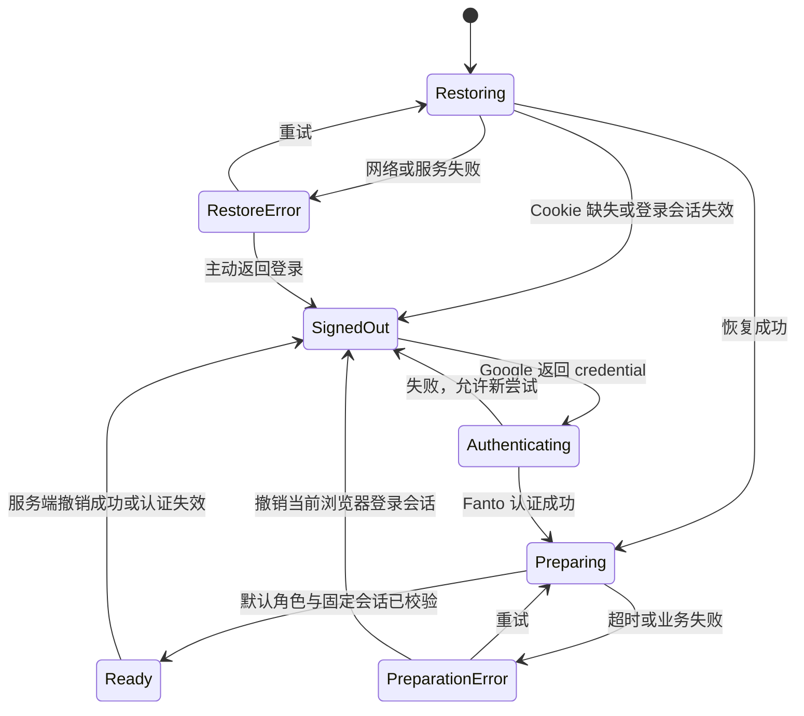
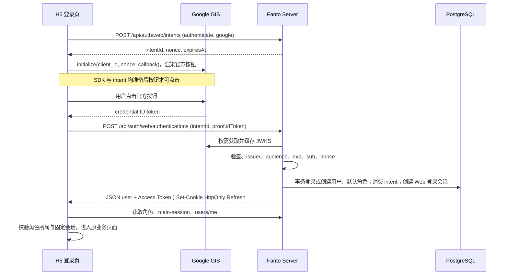
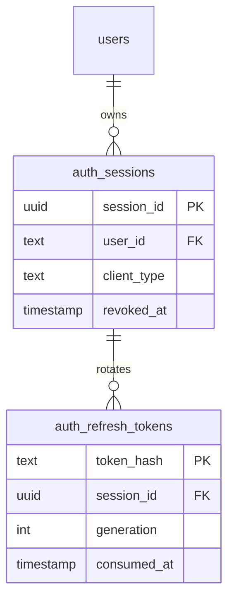

# H5 Google 登录与品牌启动页方案

日期：2026-10-22。状态：待执行方案，不代表已实现能力。修订：采用内存 Access Token + HttpOnly Refresh Cookie + 服务端可撤销登录会话；通用表名为 auth_sessions / auth_refresh_tokens，支持 client_type 与同一用户多端独立会话。本次仅更新方案与任务文件，不修改业务代码、env 或 Current State 文档。

## 1. 结论与已验证现状

可以基于现有 Server 实现 H5 Google 登录，无需更换认证系统或新增用户表。用户截图确认已存在 Web application 类型的 OAuth 客户端，并在表单中填写 `https://fanto.robinverse.me`；截图不能证明最近修改已保存、Audience 已正确配置或线上联调通过。

- H5：React 19 / Vite SPA、React Router、普通 CSS 和已有 CSS 变量，无 Tailwind、无通用 UI 组件库。当前启动先执行 `initializeTestSession`，成功才挂载 React Router；业务请求与 SSE 均依赖 `auth/test-session.ts`。全局样式以浅色为主，未发现完整深色主题。
- Server：已装配 GoogleIdentityProvider，存在 `intents`、`authentications`、`tokens/refresh` 和 `users/me`。认证按 Google sub 唯一识别，不按邮箱合并；新用户在事务中创建默认 Fanto 和固定 Session；challenge 10 分钟有效且只能消费一次。
- Token：Access 30 分钟、Refresh 30 天，刷新签发新令牌但旧 Refresh 不会立即失效。没有服务端 logout/revoke 会话 API。
- FantoProvider：并行读取 main-session、角色列表、users/me，校验默认角色与固定 Session 后选择角色；数据尚未准备时 ChatPage 已可挂载。正式入口需在首次数据准备完成前阻止聊天请求。
- iOS 登录参考：`AuthenticationEntryView.swift` 使用 FantoLoginSprite、Pieces become something.、Google / Apple 按钮、协议说明；`LoginBackground.swift` 是蓝到奶油色渐变。`StartupExperienceView.swift` 使用 FantoStartupSprite 和同一标语。`AuthenticationGateView.swift` 在恢复身份和准备本地数据时复用稳定启动页，网络业务读取不全部阻塞启动。
- 前序聊天玻璃效果与方案已提交；本次更新前工作区干净。执行前仍须重新检查工作区，局部合并，不覆盖其他工作。

## 2. 产品范围

交付：未登录首页、Google 登录、关闭浏览器后恢复登录、登录后首次角色初始化、明确的失败与重试、当前浏览器会话退出与服务端撤销。

继续复用现有多角色与固定 Session，不新增 onboarding、营销官网、Apple/短信登录、匿名账号或账号绑定页面。业务请求继续使用 Bearer Access JWT；新增仅供 Web 的 HttpOnly Refresh Cookie，以及支持 client_type 的通用 PostgreSQL 登录会话模型。关闭浏览器后，只要 Cookie 与服务端会话仍有效，就能恢复登录。保留 iOS 现有 JSON Token 契约；不引入 BFF、Redis、设备列表、踢下线或全部设备退出（页面与 API 均不新增）。同一用户可拥有多条独立登录会话，登录/刷新/退出不能覆盖或撤销其他端会话。登录会话与 Agent 对话 Session 是两个独立概念，不能复用 agent_session 表。

## 3. 页面与视觉

### 未登录首页

- 它是应用入口页，不做长营销页面。沿用 iOS 的背景、精灵和标语，移动端纵向排列，桌面端仍用居中单列，无边框登录大卡片。
- 唯一主操作：Google 官方按钮。次级内容：登录错误与重试。三级内容：协议与隐私链接。没有 Apple、游客体验或独立注册按钮；首次 Google 登录自动创建账号。
- 初始布局：内容宽度 `min(100% - 48px, 400px)`；移动端精灵约 156px，标语约 20px/600，图文间距 24px；Google 按钮宽度以 320–360px 为目标且不超容器，位于下半区，具体外观和尺寸以 GIS 官方组件允许值为准。错误区保留空间，防止按钮跳动。底部说明约 12–14px，保证实测对比度。
- 背景源自 iOS：浅色 `rgb(209,232,252)` 到 `rgb(255,247,230)`；认证页变量限定在自身容器，不改变聊天全局主题。首期浅色与现有 H5 一致；不单独让登录页跟随系统变暗而聊天仍是浅色。
- 复用 iOS 的 FantoLoginSprite 与 FantoStartupSprite 原始资源，实施时导出到 H5 自身 assets，固定图片宽高并优化体积，不从 Swift 源路径运行时加载。不重新生图，不使用用户头像代替品牌素材。
- `100dvh`、安全区 padding、小高度可滚动；验证 375px、390px、1280px。键盘焦点可见；状态使用 aria-live。只用短淡入，支持 reduced-motion，无强制播放或最低等待时间。
- 协议与隐私目标沿用 `/terms`、`/privacy` 的约定，但当前文档说内容尚待发布；正式公开前必须落实可访问内容及路由，不能把登录首页重定向当作协议页面。未有实际内容时不展示伪链接或宣称用户同意了不可阅读的条款。

### 品牌启动页

全屏同一渐变、居中启动精灵（约 180–210px）和同一标语。启动恢复与首次角色准备复用一个稳定实例，不重复播放入场。短等待只显示品牌；约 1 秒后显示真实状态“正在恢复登录…”或“正在准备你的 Fanto…”。没有假进度条。

身份恢复与首次角色 API 设定请求超时（建议 15 秒），失败立即进入可操作错误状态：“暂时无法连接”，主操作“重试”，次级“返回登录”。保留有效身份；只有明确认证失效才自动返回未登录页。头像、历史消息和外部模型不作为全局启动完成条件，交给聊天页原有加载/失败状态。

H5 没有 iOS 的业务快照体系，不为了复制启动体验新增缓存系统。H5 首次只等待已有默认角色与固定 Session 的必要校验，后续刷新不重新遮住整个应用。

## 4. 导航与状态

`main.tsx` 应同步挂载 Router 与 AuthProvider，不在 React 挂载前等待网络。`/` 为未登录首页；已登录访问 `/` 跳到 `/chat`。原有业务路由受 AuthGate 保护；未登录深链保存站内允许路径，登录后恢复。returnTo 只接受既有业务路由，拒绝外部 URL；不要消费 OAuth credential query 参数。



Auth 状态与业务准备状态分别管理，错误带来源与是否可重试。只有身份确认后才挂载 FantoProvider；首次准备成功后挂载 ChatPage。不要把首次准备与后续角色刷新共用同一个全屏遮挡条件。

## 5. Google 与 Server 链路

采用 GIS JavaScript API 的官方按钮 + popup callback，不采用授权码交换或 redirect POST。使用官方 SDK 不需要增加第三方 React 登录依赖；Client Secret 不进入 H5 或这条服务端认证链路。



关键实现约束：

- 登录页只初始化登录 SDK，不能通过需要 JWT 的 authorizedFetch 创建 intent，避免启动循环。SDK 加载 Promise 去重；每次登录尝试绑定唯一 intent、nonce 和 attemptId，回调只消费一次。React 重渲染不能重复初始化 SDK。
- intent 在按钮启用前准备好，不能在原生 Google 按钮点击回调中异步获取后再试图开启 popup。临近过期时撤下旧按钮，受控准备新尝试后再显示；不依靠高频轮询，失败后显式重试。
- GIS 关闭弹窗不保证提供统一失败回调，不假设不存在的 error_callback。等待 credential 时保持登录页；仅提交 Server 期间进入提交状态。用 attemptId 丢弃旧 credential；超时后允许准备新尝试。
- 认证 POST 结果丢失时不自动重发同一 proof；challenge 可能已消费。重新创建 intent 取得新凭证。服务端返回首次登录唯一性冲突或未知 500 时同样走新尝试，不由前端创建第二个用户。

配置：新增 `VITE_GOOGLE_CLIENT_ID`。Server 的 `GOOGLE_ALLOWED_CLIENT_IDS` 加入相同 Web Client ID，保留 iOS 所需既有 audience；新增精确的 `AUTH_WEB_ORIGIN` 与 Web 会话寿命配置，细节见第 6 节。实施时核对截图对应 ID 与现有配置是否已相同，不能因为名称不同就重复创建。H5 env.example 只放占位 ID，移除 `VITE_H5_TEST_AUTH` / `VITE_H5_TEST_REFRESH_TOKEN` 的正式入口支持；清除旧 `fanto.h5.test-auth.tokens`，不迁移为正式身份。

Google Cloud 检查授权来源与实际域名一致；本地调试另加实际 localhost 来源与端口。确认 Audience 的测试用户或发布状态。域名最近修改需保存并等待生效。Nginx 复用 HTTPS 与 `/api`；检查实际 CSP/COOP/FedCM 与弹窗兼容性，按官方要求调整，不盲目覆盖已有响应头。部署需重新构建 H5并重启 Server，最终做真实账号验收。

## 6. 通用登录会话、Web 安全边界与兼容

### 6.1 凭证保存与生命周期

- Access Token 只在当前标签页内存保存，不放 localStorage、sessionStorage、IndexedDB 或 URL。业务请求仍用 Authorization: Bearer。Web Access JWT 增加签名保护的 `sid` 和 `auth_client=web`，`sid` 指登录会话 ID；服务端校验签名、有效期、audience 后检查该 sid 所属用户、client_type=web、有效期、撤销状态与用户 active 状态。
- Refresh 使用至少 32 随机字节的不透明 Token，不复用现有原生客户端 Refresh JWT。原文仅存在浏览器 Cookie 与签发时内存，数据库只保存 SHA-256 摘要，API JSON、日志、前端代码均不暴露原文。
- Cookie 固定为 `__Host-fanto-refresh`，`HttpOnly; Secure; SameSite=Lax; Path=/`，不设置 Domain。设置 Max-Age 支持浏览器重启后保留；使用同名、同 Path 属性清除。Path=/ 是 __Host- 前缀要求，业务接口即便收到 Cookie 也不以它认证。
- 建议首期 Web Access 仍为 30 分钟；Refresh 空闲期 30 天、登录会话绝对上限 90 天，每次成功刷新将空闲期延长至 min(now+30天,绝对上限)。Cookie Max-Age 与服务端截止时间一致，不能只延长 Cookie。配置项：AUTH_WEB_ORIGIN、AUTH_WEB_REFRESH_TTL_SECONDS（2592000）、AUTH_WEB_SESSION_MAX_TTL_SECONDS（7776000）；现有原生 TTL 保持不变。
- 每次 Web 业务请求都查询会话状态，不接入当前 24 小时 userStatusCache 来判断 Web 撤销；不使用会延迟撤销生效的跨请求正向缓存。数据库不可用返回可重试 503，不能放行或伪装成令牌过期。撤销后的新请求立即拒绝；已开始的请求、工具和 SSE 不被承诺回滚或立即中断，前端退出时立即分离流与卸载业务树。

### 6.2 独立 Web HTTP 契约

继续使用现有统一信封。新增四个 Web 端点，客户端类型由 Route 调用的服务方法决定，不相信 JSON 中的 clientType/transport 开关。

| 方法与路径 | 输入与认证 | 成功结果 |
| --- | --- | --- |
| POST /api/auth/web/intents | JSON purpose=authenticate、provider=google；Web 来源校验 | intentId、nonce、expiresAt；绑定为 Web 用途 |
| POST /api/auth/web/authentications | intentId、proof.idToken；Web 来源校验及 Web intent | JSON user、accessToken、accessTokenExpiresAt；Set-Cookie Refresh；不返回 refreshToken |
| POST /api/auth/web/refresh | 空 JSON、Refresh Cookie；Web 来源校验 | 轮换 Cookie；JSON user、accessToken、accessTokenExpiresAt |
| POST /api/auth/web/logout | 空 JSON、Refresh Cookie；可选仍有效 Web Bearer 辅助定位；Web 来源校验 | 204；撤销当前登录会话并清除 Cookie；重复调用幂等 |

Web intent 在 auth_challenges.context 中标记可信的 delivery=web，由 Web 路由在服务内写入并检查；通用/native intent 不可在 Web 交换端点使用，Web intent 也不可在原生交换端点消费，nonce 与一次性消费规则仍保留。

Web 认证在同一业务事务中完成身份解析/新建、默认 Fanto、challenge 消费与 Web 会话创建，避免 challenge 已消费而会话未落库。AuthService 复用内部身份认证流程，通过 AuthSessionService 在同一个 Transaction 创建会话；不先调用现有 authenticate 签发原生 Refresh JWT 再转包装 Cookie，也不复制身份业务逻辑。成功签发 Access 后才返回 Set-Cookie；失败只留下可解释、无凭证可用的结果，不自动重放认证 proof。

现有 `/api/auth/intents`、`/auth/authentications`、`/auth/registrations`、`/auth/logins`、`/auth/tokens/refresh` 保留原生契约；iOS 不需要修改。原生刷新只接受已有 Refresh JWT，拒绝 Web 不透明 token；Web refresh 只接受 Cookie 并查询 Web 会话，禁止 JSON refreshToken 或 native JWT 回退。带 auth_client=web 却缺少 sid 的 JWT 必须拒绝；已签名原生 JWT 保持原流程。

### 6.3 通用数据结构、多端登录与事务轮换

新增前向迁移（当前已存在 001–003，预期为 `004_create_auth_sessions.ts`；执行前按最新仓库重新确定编号），不修改旧迁移或用户表：

| 表 | 字段与约束 |
| --- | --- |
| auth_sessions | session_id UUID PK、user_id（与 users 类型一致）、client_type TEXT NOT NULL CHECK IN (web, ios)、created_at、last_refreshed_at、idle_expires_at、absolute_expires_at、revoked_at、revocation_reason；用户外键、(user_id, client_type) 非唯一索引与清理索引 |
| auth_refresh_tokens | token_hash PK、session_id FK、issued_at、expires_at、consumed_at、generation；session_id+generation 唯一；session_id 索引；不保存原文 |

多端约束：

- 一个 user 对应多个 auth_sessions，一条 auth_session 对应多条 auth_refresh_tokens；不对 user_id 或 (user_id, client_type) 建唯一约束。同一用户可同时登录多台设备、多个浏览器，多个 web 或 ios 会话也不互相覆盖。
- client_type 表达客户端类别，首期定义为 web / ios，不是设备 ID、浏览器指纹或登录 Provider。Google / Apple 身份仍属于 user_login_identities，不能把 provider 当成 client_type；本期不额外收集设备名称、IP 画像或 User-Agent 来建设设备管理。
- client_type 由服务端可信认证入口指定，不从请求 body、Header 或未校验 JWT 直接采信。Web 路由固定写 web；Web Access 中 auth_client 必须与数据库对应会话的 client_type 一致。通用 AuthSessionService 内部显式接收受控 clientType；Cookie 适配与 Web 来源校验留在 auth-web Route，通用会话服务不依赖 Cookie。
- auth_refresh_tokens 通过 session_id 继承客户端类别，不重复存 client_type。刷新、轮换、重用检测和退出都只作用于该 session_id；不能按 user_id 或 client_type 批量撤销。同一浏览器多标签页共享 Cookie，复用同一 web 登录会话；不同浏览器/设备分别创建 session_id。
- 本期 H5 新认证链路写入 client_type=web；ios 是通用模型支持的类别，不代表本期已将原生登录迁入新表。iOS 既有 JSON Refresh JWT 与客户端 Keychain 流程保持不变，本期不改 iOS 代码、不将无 sid 的历史原生 JWT 自动注册为新会话。后续原生接入时由原生入口固定指定 ios 并复用通用会话服务，传输仍可使用 JSON + Keychain。
- 不新增设备列表、踢下线、全部设备退出的 Service 对外能力或 HTTP API；只实现当前会话的必要撤销。通用命名和索引用于正确承载多会话，不提前建设设备管理。



签发新 token 与消费旧 token 在会话行锁内的一个事务完成；并发刷新至多一个成功。被消费的摘要保留至整个会话失效及短期清理窗口结束，用于识别旧 token 重用；未知摘要只拒绝，不能根据未经验证的参数撤销任意用户会话。保留窗口定为 7 天；后台清理仅处理已绝对过期超过 7 天或已撤销超过 7 天的登录会话并级联清理 token，独立幂等运维命令按天执行，不把清理绑到每次业务请求。

跨标签页使用 Web Locks（可用时）串行化 Cookie 变更请求，并用 BroadcastChannel 只广播退出/账号变化/重新恢复事件，绝不广播或持久化 token。不支持 Web Locks 时仍由服务端行锁保证正确性。

轮换冲突策略：已消费 token 在 10 秒并发宽限内返回 409 AUTH_REFRESH_CONFLICT，不签发 token、不 Set-Cookie、不撤销整个会话；客户端在其他刷新完成后最多再尝试一次，使用浏览器当前 Cookie。超过宽限再次提交已消费 token 撤销该会话并返回 401 AUTH_SESSION_REVOKED。宽限内旧 token 本身不能换出新凭证，不成为第二个有效 Refresh。响应丢失且 Cookie 未更新时，有限重试仍不能恢复则明确重新登录，不无限重试、不将原文 token 保存到数据库做补偿。

### 6.4 Cookie / CSRF / CORS

- 所有 Web 认证 POST（包括 intent 和登录，防止 login CSRF）要求 Content-Type: application/json、`X-Fanto-Web: 1`，并严格比较 Origin 与 AUTH_WEB_ORIGIN。此固定头只是非简单请求标记，不冒充秘密 CSRF token；防护依赖精确 Origin + 自定义头 + 不开放跨域 credentials。缺失、null 或不匹配 Origin 都返回 403 WEB_ORIGIN_FORBIDDEN；不能拿请求 Host/任意转发头动态构建允许来源。
- Web 端点不使用现有全局 `cors(origin:"*")` 策略；在 app.ts 按路径分离，跨域 Web 请求及预检不获允许，无反射 Origin，也不配置通配 credentials。原生/既有接口保持自己的行为。网页发起同源 fetch 时显式 credentials=same-origin；Cookie 只用于 Web 登录会话维护。
- JSON 与 Set-Cookie 认证响应 Cache-Control: no-store；access/refresh/Cookie/Set-Cookie/Authorization 不进入日志。SameSite 是额外防线，不替代来源检查；HttpOnly 降低凭证读取风险，不替代 XSS 防护。既有 Bearer 业务接口不改成自动读取 Cookie。
- 生产要求 HTTPS；本地通过 HTTPS H5 开发入口代理 `/api` 并配置精确本地 Origin，证书由本机提供、不提交。保持 Secure 与 __Host- 语义，不为生产添加不安全开关。Vite HTTPS 仅在本地显式证书配置时开启，其余旧开发入口不静默破坏。

### 6.5 恢复、退出与账号隔离

- 启动无论前端有无用户数据，都只执行一次 Cookie refresh 来判断身份，因为 JS 不能读取 HttpOnly Cookie。无 Cookie、已过期或已撤销返回 401 并清理 Cookie、显示首页；网络/429/503 保留现有登录可能性并提供重试，不自动清 Cookie。恢复响应中的 user 才是身份依据。
- 单标签页刷新 Promise 去重；业务 401 最多刷新并重试一次，普通业务 403 不触发退出。服务端必须在执行副作用前完成身份校验，不能把业务写入已执行后的异常伪装成认证 401。保留未知结果写操作不自动重发的原有约束。
- 维护 session generation 拒绝旧 refresh/业务响应写回；FantoProvider 与业务树按 userId+generation 重建。退出确认后立即停止本地发新业务请求、分离 SSE、清理当前账号内存及对应本地草稿/选择；不清除其他账号数据，也不重绑对话 Session。
- logout 不依赖 Access 未过期：当前/已消费 Refresh 的摘要都可在校验后定位并撤销该会话；同时有 Bearer 时只能接受同一 sid，不能按请求任意 userId 撤销。服务端撤销与 refresh 共用会话行锁，返回成功前已提交撤销。即使旧 refresh 响应晚到写回 Cookie，该 sid 仍被服务端拒绝。
- 仅 generation 无法阻止浏览器处理晚到的 Set-Cookie。登录/刷新/退出应串行化至响应落定；用户取消或退出时不简单 abort 已提交登录后假装一切已结束，若登录最终成功须完成该会话 logout。新登录不能与未处理完的旧登录并发安装；跨标签页账号改变要通知其他标签页丢弃 Access 与旧页面并重新校验。
- 网络失败不能宣称“已退出”：进入退出待确认状态，前端业务已清理/禁用，提供重试；不自动 refresh 恢复被用户要求退出的身份。logout 结果未知时先重试幂等 logout，确认后才回正常未登录首页。服务端成功并清 Cookie 后，其他标签页收到通知并清理；即使漏收通知，旧 sid 的业务请求也被拒绝。
- `/fantos` 菜单提供“退出登录”，含确认。退出只撤销本浏览器对应会话（同源多个标签页共享），不撤销其他设备，不撤销 Google 授权或 Google 全局登录；GIS disableAutoSelect 避免自动选回。
- 清除旧 `fanto.h5.test-auth.tokens`，不迁移固定测试身份。角色选择、待清理删除与草稿仍按现有用户/对话作用域管理，sessionStorage 可继续保存非认证业务状态。

## 7. Server 最小补充

新增 Web 响应及 Cookie 契约，保持原生端成功响应与用户身份隔离约束。上线前补充 Google token 的 `exp` 必填约束（当前 jwtVerify 只检查存在的 exp）；为错误 issuer、签名、过期、缺失 sub/nonce/exp 与错误 audience 增加覆盖。

当前 email_verified=false 时也会保存邮箱。登录继续以 sub 为准，不强制账号必须有邮箱；明确 contact_value 是签名 token 返回的联系方式，不代表独立验证过邮箱所有权。若产品今后依赖邮箱验证，另行定义，不在本期擅自更改联系方式领域语义。

JWKS 请求失败目前被统一转成 INVALID_PROVIDER_PROOF。应区分可识别的上游网络/超时/临时服务故障与真正的验签失败：前者用可重试 503 Provider unavailable 错误（扩展 AuthError 状态并更新契约），后者保持 400；未知 key / 验签错误不能一律当网络错误。日志继续脱敏。

## 8. 验证与发布边界

单元与集成：Cookie 属性/清除/不出现在 JSON、Origin 与自定义头/CORS 拒绝、Web/native proof 与 refresh 通道隔离、同用户多个同类型会话共存/client_type约束与可信赋值/按sid隔离刷新及退出、无会话与浏览器重启恢复、空闲与绝对期限、轮换重放/宽限/跨标签页并发/响应丢失、撤销后旧 Access 拒绝、退出期间晚到 Set-Cookie 与登录结果、退出失败不误报、跨账号晚到响应、intent 过期与回调去重、首次/已有用户及原生回归、nonce 重放、固定角色一致性、初始化失败不清身份。PG 测试只用独立 TEST_DATABASE_URL，不连接实际业务库进行写测试。

浏览器：375/390/1280 宽度；低高度和大字体；键盘与屏幕阅读状态；Chrome / Safari / iOS Safari 的 Google popup；取消、被拦截、SDK 不可达、Server 断网、429/503、刷新、浏览器关闭重开、多标签页退出与重登。保持角色切换、草稿、删除和 SSE 回归。正常登录验收不调用付费模型。

执行检查：H5 typecheck/test/build、Server typecheck 和相关认证测试，按改动范围再跑仓库要求。mock 只验证本地状态与协议；真实 Google、Google Cloud、线上 Nginx、数据库和账号归属必须分别实测。本次仅做方案，未执行页面实现或视觉验收。

实现完成后同步 apps/h5/AGENTS.md、docs/clients/h5.md、配置/本地开发、产品范围和架构概览，必要时根 README；API docs 描述新增 Web endpoints、Cookie/CSRF、sid 校验、轮换/撤销与错误约定；Users 文档区分登录会话与登录身份。不把方案提前写成 Current State，也不因局部文档更新推进 docs/.checkpoint。

## 9. 目标变更目录

下列为预计变更范围，新增文件名可在实施时按现有风格微调；不是本次已产生的代码变更。

```text
apps/h5/
├── .env.example                         修改：Google Web Client ID，移除固定测试认证
├── vite.config.ts                       修改：可选本地 HTTPS 入口，保留 API 代理
├── AGENTS.md                            修改：正式认证、Cookie 与账号隔离约束
├── public/assets/fanto/auth/             新增：复用 iOS 登录/启动精灵资源
├── src/
│   ├── main.tsx                         修改：立即挂载认证树
│   ├── config.ts                        修改：Web Client ID
│   ├── vite-env.d.ts                    修改：env 类型
│   ├── app/App.tsx                      修改：公开入口与受保护路由
│   ├── auth/
│   │   ├── test-session.ts              删除：测试令牌入口
│   │   ├── session.ts                   新增：内存 Access、Cookie 恢复、跨标签页协调
│   │   ├── AuthProvider.tsx             新增：认证状态与 generation
│   │   ├── AuthGate.tsx                 新增：恢复与首次准备门禁
│   │   ├── google-identity.ts           新增：SDK 加载和 intent/nonce 尝试
│   │   ├── GoogleSignInButton.tsx       新增：官方按钮
│   │   ├── LoginPage.tsx                新增：未登录首页
│   │   ├── StartupExperience.tsx        新增：稳定品牌启动/失败重试
│   │   └── auth.css                     新增：认证页局部视觉变量
│   ├── api/auth.ts                      新增：Web intent/authenticate/refresh/logout
│   ├── api/http.ts                      修改：通用授权与错误传播
│   ├── api/agent.ts                     修改：接入通用授权，保持 SSE 契约
│   └── fanto/
│       ├── FantoContext.tsx             修改：首次准备、账号会话隔离
│       └── FantoListPage.tsx            修改：退出与待确认状态
└── tests/                               新增：认证/恢复/并发/退出/路由状态测试
apps/server/
├── .env.example                         修改：AUTH_WEB_ORIGIN 和 Web 会话期限
├── AGENTS.md                            修改：Web 会话、撤销与认证边界
└── src/
    ├── bootstrap/
    │   ├── config.ts                    修改：精确 Web Origin 与期限校验
    │   ├── main.ts                      修改：服务装配
    │   ├── app.ts                       修改：Web 路由、公有入口、CORS、sid 校验、脱敏
    │   └── cleanup-auth-sessions.ts  新增：通用过期登录会话清理命令
    ├── routes/
    │   ├── auth-web.ts                  新增：Cookie 适配、Origin 与非简单头校验
    │   ├── auth-web.test.ts             新增：Cookie/CSRF/响应/兼容测试
    │   └── auth.test.ts                 修改：原生契约回归
    ├── domain/auth/
    │   ├── auth-service.ts              修改：共享身份认证、Web intent 与事务会话创建
    │   ├── auth-session-service.ts       新增：client_type、hash、会话轮换、期限与当前会话撤销/清理
    │   ├── auth-session-service.integration.test.ts 新增：隔离 PG 并发/撤销回归
    │   ├── auth-service.integration.test.ts 修改：原生/Web 通道与事务回归
    │   ├── errors.ts                    修改：503 及 Web 错误语义
    │   └── index.ts                     修改：领域导出
    ├── infrastructure/auth/
    │   ├── jwt-token-service.ts         修改：签发/验证 Web sid 与 client claims
    │   ├── jwt-token-service.test.ts    修改：Web/native claim 边界
    │   └── providers/google-identity-provider* 修改：exp 与 JWKS 故障区分及测试
    ├── infrastructure/database/schema.ts 修改：两张通用登录会话表与 client_type 的类型
    └── migrations/004_create_auth_sessions.ts 新增：按执行时最新编号创建
```

配套目标：apps/server/package.json 增加清理命令；部署运维按日执行它，采用已有运维调度设施，不引入队列或新后台框架。deploy/manual/nginx/fanto-ssl.conf 检查 Cookie 透传、缓存与 GIS 响应头，只有确有需要才修改；不因 Cookie 本身改变公网代理拓扑。

实现后同步 docs/clients/h5.md、docs/domain/users.md、docs/api/http-api.md、docs/engineering/configuration.md、docs/engineering/local-development.md、docs/engineering/testing.md、docs/product/current-scope.md、docs/architecture/overview.md、docs/architecture/server.md 与根 README 的相关描述。仅在事实影响时修改，不复制重复事实。iOS 目录、Agent 对话实现、既有迁移 001–003 不在目标变更范围。

## 10. 官方参考

- https://developers.google.com/identity/gsi/web/reference/js-reference
- https://developers.google.com/identity/gsi/web/guides/get-google-api-clientid
- https://developers.google.com/identity/gsi/web/guides/integrate
- https://cheatsheetseries.owasp.org/cheatsheets/Session_Management_Cheat_Sheet.html
- https://cheatsheetseries.owasp.org/cheatsheets/Cross-Site_Request_Forgery_Prevention_Cheat_Sheet.html
- https://developer.mozilla.org/en-US/docs/Web/API/Web_Locks_API

任务拆解见同目录 `2026-10-22-h5-google-auth-tasks.md`。
