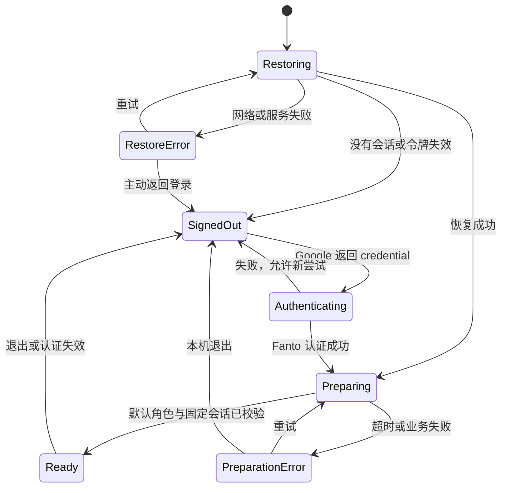
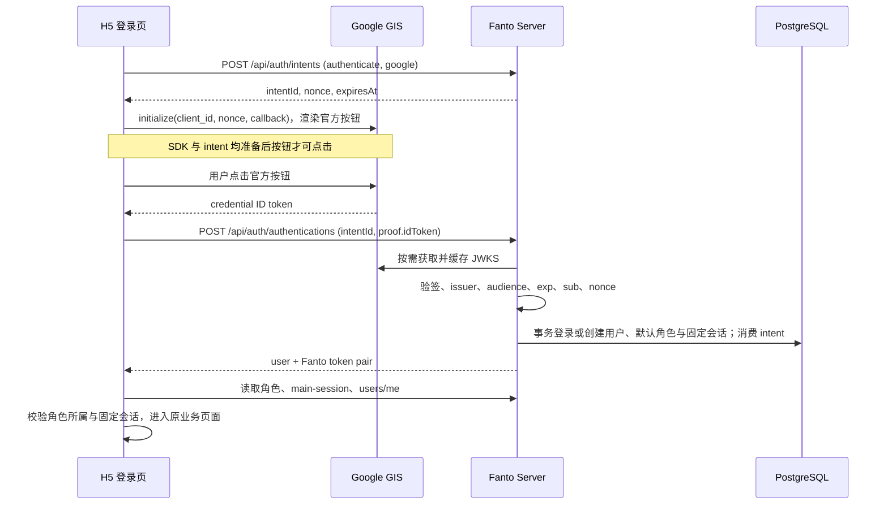

# H5 Google 登录与品牌启动页方案

日期：2026-10-22。状态：待执行方案，不代表已实现能力。本次仅新增方案与任务文件，不修改业务代码、env 或 Current State 文档。

## 1. 结论与已验证现状

可以基于现有 Server 实现 H5 Google 登录，无需更换认证系统或新增用户表。用户截图确认已存在 Web application 类型的 OAuth 客户端，并在表单中填写 `https://fanto.robinverse.me`；截图不能证明最近修改已保存、Audience 已正确配置或线上联调通过。

- H5：React 19 / Vite SPA、React Router、普通 CSS 和已有 CSS 变量，无 Tailwind、无通用 UI 组件库。当前启动先执行 `initializeTestSession`，成功才挂载 React Router；业务请求与 SSE 均依赖 `auth/test-session.ts`。全局样式以浅色为主，未发现完整深色主题。
- Server：已装配 GoogleIdentityProvider，存在 `intents`、`authentications`、`tokens/refresh` 和 `users/me`。认证按 Google sub 唯一识别，不按邮箱合并；新用户在事务中创建默认 Fanto 和固定 Session；challenge 10 分钟有效且只能消费一次。
- Token：Access 30 分钟、Refresh 30 天，刷新签发新令牌但旧 Refresh 不会立即失效。没有服务端 logout/revoke 会话 API。
- FantoProvider：并行读取 main-session、角色列表、users/me，校验默认角色与固定 Session 后选择角色；数据尚未准备时 ChatPage 已可挂载。正式入口需在首次数据准备完成前阻止聊天请求。
- iOS 登录参考：`AuthenticationEntryView.swift` 使用 FantoLoginSprite、Pieces become something.、Google / Apple 按钮、协议说明；`LoginBackground.swift` 是蓝到奶油色渐变。`StartupExperienceView.swift` 使用 FantoStartupSprite 和同一标语。`AuthenticationGateView.swift` 在恢复身份和准备本地数据时复用稳定启动页，网络业务读取不全部阻塞启动。
- 本次工作区已有聊天输入、ChatPage、全局 CSS、H5 文档与 LiquidGlass 组件的用户改动。执行时基于最新文件做局部合并，不覆盖或重置。

## 2. 产品范围

交付：未登录首页、Google 登录、刷新恢复、登录后首次角色初始化、明确的失败与重试、本机退出。

继续复用现有多角色与固定 Session，不新增 onboarding、营销官网、Apple/短信登录、匿名账号或账号绑定页面。本期保持 Bearer JWT 接口，不引入 Cookie/BFF、服务端 Session 表或跨设备注销。关闭标签页后需要重新登录是首期明确的产品边界。

## 3. 页面与视觉

### 未登录首页

- 它是应用入口页，不做长营销页面。沿用 iOS 的背景、精灵和标语，移动端纵向排列，桌面端仍用居中单列，无边框登录大卡片。
- 唯一主操作：Google 官方按钮。次级内容：登录错误与重试。三级内容：协议与隐私链接。没有 Apple、游客体验或独立注册按钮；首次 Google 登录自动创建账号。
- 初始布局：内容宽度 `min(100% - 48px, 400px)`；移动端精灵约 156px，标语约 20px/600，图文间距 24px；Google 按钮宽度以 320–360px 为目标且不超容器，位于下半区，具体外观和尺寸以 GIS 官方组件允许值为准。错误区保留空间，防止按钮跳动。底部说明约 12–14px，保证实测对比度。
- 背景源自 iOS：浅色 `rgb(209,232,252)` 到 `rgb(255,247,230)`；认证页变量限定在自身容器，不改变聊天全局主题。首期浅色与现有 H5 一致；不单独让登录页跟随系统变暗而聊天仍是浅色。
- 复用 iOS 的 FantoLoginSprite 与 FantoStartupSprite 原始资源，实施时导出到 H5 自身 assets，固定图片宽高并优化体积，不从 Swift 源路径运行时加载。不重新生图，不使用用户头像代替品牌素材。
- `100dvh`、安全区 padding、小高度可滚动；验证 375px、390px、1280px。键盘焦点可见；状态使用 aria-live。只用短淡入，支持 reduced-motion，无强制播放或最低等待时间。
- 协议与隐私目标沿用 `/terms`、`/privacy` 的约定，但当前文档说内容尚待发布；正式公开前必须落实可访问内容及路由，不能把登录首页重定向当作协议页面。未有实际内容时不展示伪链接或宣称用户同意了不可阅读的条款。

### 品牌启动页

全屏同一渐变、居中启动精灵（约 180–210px）和同一标语。启动恢复与首次角色准备复用一个稳定实例，不重复播放入场。短等待只显示品牌；约 1 秒后显示真实状态“正在恢复登录…”或“正在准备你的 Fanto…”。没有假进度条。

首次角色 API 设定请求超时（建议 15 秒），失败立即进入可操作错误状态：“暂时无法连接”，主操作“重试”，次级“返回登录”。保留有效身份；只有明确认证失效才自动返回未登录页。头像、历史消息和外部模型不作为全局启动完成条件，交给聊天页原有加载/失败状态。

H5 没有 iOS 的业务快照体系，不为了复制启动体验新增缓存系统。H5 首次只等待已有默认角色与固定 Session 的必要校验，后续刷新不重新遮住整个应用。

## 4. 导航与状态

`main.tsx` 应同步挂载 Router 与 AuthProvider，不在 React 挂载前等待网络。`/` 为未登录首页；已登录访问 `/` 跳到 `/chat`。原有业务路由受 AuthGate 保护；未登录深链保存站内允许路径，登录后恢复。returnTo 只接受既有业务路由，拒绝外部 URL；不要消费 OAuth credential query 参数。

Auth 状态与业务准备状态分别管理，错误带来源与是否可重试。只有身份确认后才挂载 FantoProvider；首次准备成功后挂载 ChatPage。不要把首次准备与后续角色刷新共用同一个全屏遮挡条件。

## 5. Google 与 Server 链路

采用 GIS JavaScript API 的官方按钮 + popup callback，不采用授权码交换或 redirect POST。使用官方 SDK 不需要增加第三方 React 登录依赖；Client Secret 不进入 H5 或这条服务端认证链路。

关键实现约束：

- 登录页只初始化登录 SDK，不能通过需要 JWT 的 authorizedFetch 创建 intent，避免启动循环。SDK 加载 Promise 去重；每次登录尝试绑定唯一 intent、nonce 和 attemptId，回调只消费一次。React 重渲染不能重复初始化 SDK。
- intent 在按钮启用前准备好，不能在原生 Google 按钮点击回调中异步获取后再试图开启 popup。临近过期时撤下旧按钮，受控准备新尝试后再显示；不依靠高频轮询，失败后显式重试。
- GIS 关闭弹窗不保证提供统一失败回调，不假设不存在的 error_callback。等待 credential 时保持登录页；仅提交 Server 期间进入提交状态。用 attemptId 丢弃旧 credential；超时后允许准备新尝试。
- 认证 POST 结果丢失时不自动重发同一 proof；challenge 可能已消费。重新创建 intent 取得新凭证。服务端返回首次登录唯一性冲突或未知 500 时同样走新尝试，不由前端创建第二个用户。

配置：新增 `VITE_GOOGLE_CLIENT_ID`。Server 的 `GOOGLE_ALLOWED_CLIENT_IDS` 加入相同 Web Client ID，保留 iOS 所需既有 audience。实施时核对截图对应 ID 与现有配置是否已相同，不能因为名称不同就重复创建。H5 env.example 只放占位 ID，移除 `VITE_H5_TEST_AUTH` / `VITE_H5_TEST_REFRESH_TOKEN` 的正式入口支持；清除旧 `fanto.h5.test-auth.tokens`，不迁移为正式身份。

Google Cloud 检查授权来源与实际域名一致；本地调试另加实际 localhost 来源与端口。确认 Audience 的测试用户或发布状态。域名最近修改需保存并等待生效。Nginx 复用 HTTPS 与 `/api`；检查实际 CSP/COOP/FedCM 与弹窗兼容性，按官方要求调整，不盲目覆盖已有响应头。部署需重新构建 H5并重启 Server，最终做真实账号验收。

## 6. 会话、退出与隔离

复用当前 API 架构，首期 access token 以内存为主，refresh token、到期时间与 userId 保存在新的 sessionStorage key；支持同一标签页刷新恢复，关闭后重新登录。storage 写失败要转为明确的内存会话或提示，不造成启动崩溃。该选择保持现有存储范围，不宣称具备 HttpOnly 保护或长期设备登录。

- 启动只运行一次 restore，无 token 立即去首页。恢复身份使用 refresh 和 users/me 形成服务端验证，前端解析 JWT 只作到期提示，不作用户身份信任来源。
- 并发刷新合并为一个 Promise；401 最多续期并重试一次。refresh 明确返回 REFRESH_TOKEN_INVALID / USER_DISABLED / UNAUTHENTICATED 时清理；网络、429、5xx 保留会话并按场景重试，普通业务 403 不能视为退出。
- 为登录安装、退出、失效维护 session generation；刷新和业务响应写回前检查 generation。退出取消在途请求、分离 SSE并卸载用户树；退出发生后旧刷新绝不能重新安装会话。
- FantoProvider 和业务树按 userId + session generation 重建，隔离 selected/pending/draft 等已有用户与 Session 状态。删除当前账号令牌与内存、当前账号本地状态；不删除其他账号保存的数据，不请求通用创建/重绑 Session。
- 在 `/fantos` 的菜单中提供低强调“退出登录”，确认后本机清理并回首页。调用 GIS disableAutoSelect 避免立即自动选回，不 revoke Google 授权、不退出整个 Google 账号。本期没有服务端撤销，已复制的旧 Refresh 仍可能有效到过期；不把本机退出描述成全部设备注销。
- 自动重试不能扩大到未知结果的 POST、DELETE、角色 restart 等业务写操作；保留现有显式确认与核对语义。

## 7. Server 最小补充

不改既有成功响应与身份隔离契约。上线前补充 Google token 的 `exp` 必填约束（当前 jwtVerify 只检查存在的 exp）；为错误 issuer、签名、过期、缺失 sub/nonce/exp 与错误 audience 增加覆盖。

当前 email_verified=false 时也会保存邮箱。登录继续以 sub 为准，不强制账号必须有邮箱；明确 contact_value 是签名 token 返回的联系方式，不代表独立验证过邮箱所有权。若产品今后依赖邮箱验证，另行定义，不在本期擅自更改联系方式领域语义。

JWKS 请求失败目前被统一转成 INVALID_PROVIDER_PROOF。应区分可识别的上游网络/超时/临时服务故障与真正的验签失败：前者用可重试 503 Provider unavailable 错误（扩展 AuthError 状态并更新契约），后者保持 400；未知 key / 验签错误不能一律当网络错误。日志继续脱敏。

## 8. 验证与发布边界

单元与集成：无会话、有效会话恢复、过期与并发刷新、退出期间刷新回流、跨账号晚到响应、intent 过期、回调去重、首次/已有用户、nonce 重放、固定角色一致性、初始化失败不清身份。PG 测试只用独立 TEST_DATABASE_URL，不连接实际业务库进行写测试。

浏览器：375/390/1280 宽度；低高度和大字体；键盘与屏幕阅读状态；Chrome / Safari / iOS Safari 的 Google popup；取消、被拦截、SDK 不可达、Server 断网、429/503、刷新与退出重登。保持角色切换、草稿、删除和 SSE 回归。正常登录验收不调用付费模型。

执行检查：H5 typecheck/test/build、Server typecheck 和相关认证测试，按改动范围再跑仓库要求。mock 只验证本地状态与协议；真实 Google、Google Cloud、线上 Nginx、数据库和账号归属必须分别实测。本次仅做方案，未执行页面实现或视觉验收。

实现完成后同步 apps/h5/AGENTS.md、docs/clients/h5.md、配置/本地开发、产品范围和架构概览，必要时根 README；API docs 只补实际新增的错误约定。不把方案提前写成 Current State，也不因局部文档更新推进 docs/.checkpoint。

## 9. 官方参考

- https://developers.google.com/identity/gsi/web/reference/js-reference
- https://developers.google.com/identity/gsi/web/guides/get-google-api-clientid
- https://developers.google.com/identity/gsi/web/guides/integrate

任务拆解见同目录 `2026-10-22-h5-google-auth-tasks.md`。
